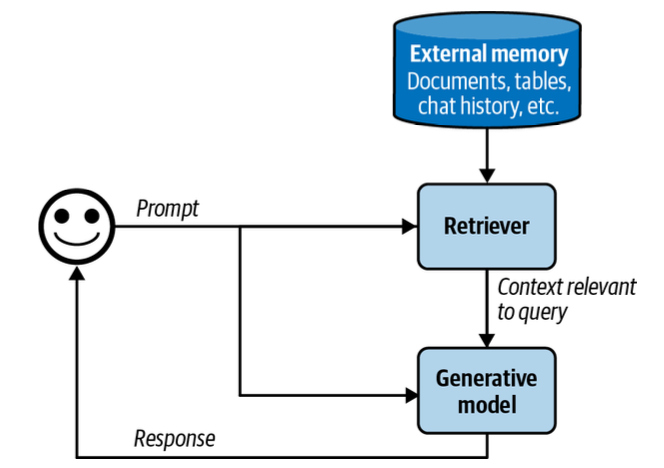
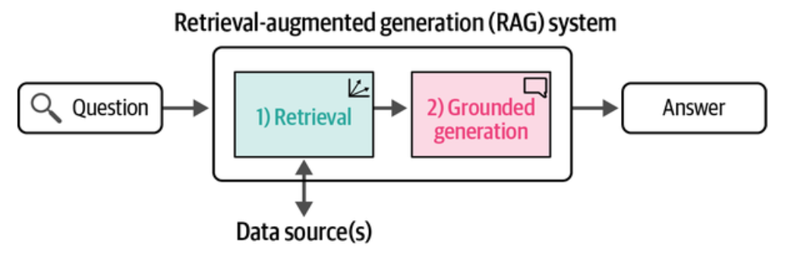
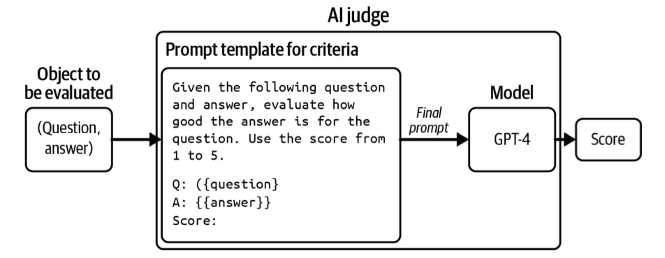
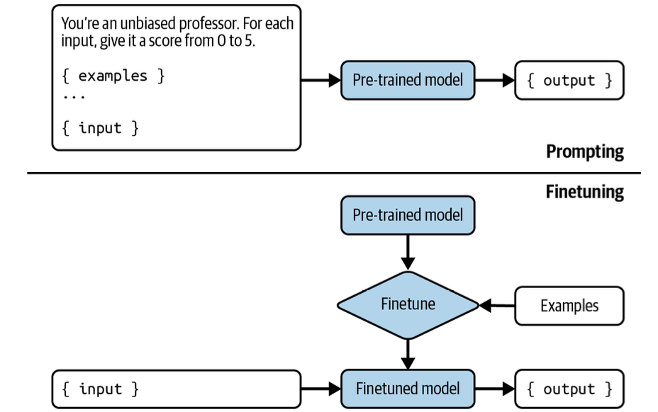

# Extracting Information from Contracts

Now that we have some idea of how LLMs work, let us see how they can help us with one of our core needs: getting information from contracts. At this point we will approach this at a very abstract level, merely concering ourselves to the extraction of a piece of information, or the summarization of a part of our contract.

Let us recall some key points about how LLMs work:

1. They predict the next token/word in a sequence of tokens.
2. They do this by having a memory (in the multi-layer perceptron part) and an attention mechanism in which the contextual correlation of words is kept(the attention part). LLMs work by interpolating from these memories using the attention mechanism.
3. What you put into the prompt is called the context of the model. Even while some models, notably `gemini` have a very large context, the shorter your context is the better your results will be. Thus, for prompting, context management becomes very important.

These factors determine how you will prompt a model. For example, if you were writing code, you might not want to provide all your code files as context for say, refactoring a particuler function..just the ones it depends on and just the ones that depend on it. Our very own Gaurav and Jeswin used a program called `tree-sitter` to provide just this context to models. Cursor and Repo-prompt also play the same trick. Or if you were writing a novel, you may only want to provide the last chapter with outlines of the second-last and so on.

## RAG

This notion of controlling context and then having the model generate stuff for you is sometimes called RAG, or retrieval-augmented generation. Here we want to control what a search retrieves to provide information (context) to the model to aid generation. For extracting relevant parts of contracts to aid a model to answer a particular question, Aniket uses a custom-written Graph RAG which retrieves relevant sections of the contract based on the strength of and the kind of links a section has to other parts of the contract.

*The external places we retrieve information form: other documents, other sections can be thought of as a shor term memory for our system, just like cache memory in a computer. It is limited in size, and so the retriever must choose the most germane information to bring in (image from AI Engineering by Chip Huyen)*

So for example, consider that you want to extract a revolver section from a contract. We now have a nice JSON based text and graph format which will allow us to get information from the contract along with all the definitions and other related information that we might possibly need. What we want to do is to stuff this relevant information into the context and then prompt the model to extract specific details that go into the revolver section of the tear sheet.

## Tinkering with our prompt

So we might try something not super smart in our prompt such as "extract details for the revolver section of the tear sheet given the following information where the following information is the relevant sections from our contract text preceded by FOLLOWING RELEVANT SECTIONS INSERTED HERE". And then the model responds to us, hopefully sending back something sensible. If this seems to you to be a somewhat stochastic process, it indeed is. It's not like regular programming when you'll always get back the same result. In fact, if you were to do this prompt multiple times, you might get back different things; remember from last time that the next token generation is probabilistic. Which is okay! Different people may phrase the relevant extractions in different ways, but the key aspect of this generation is that it is *grounded* in the context we provide it.

*Generation is grounded in the sources we provide through the RAG process. (image from AI Engineering by Chip Huyen)*

However, we must make sure that the key concepts and facts are extracted. And we might find that our prompt is not optimal. So we tinker and tinker and try and make it optimal. How do we do this? We show the outputs of the model to our domain expert. We asked them to rate the response as good or bad, and to then write a critique as to why the response was good or bad. This takes a lot of cycles of our domain expert and we try and do it as little as possible. But based on these critiques, we can improve our prompt. So now you see we have made our model a little bit better at extracting the output we want. 

If this was a coding or math system, we could use unit tests that make sure the functions do what they say, or a theorem prover. Since there are ground-truth exact answers, we are done. But extraction, summarization, write-like-Hemmingway and other such rasks dont have exact answers, and thus the ground truth needs to be judged by a human at a high cost or by...

## We use a second Judge LLM

What we want to do now is to train a second language model to do the act of **critiquing** our first model's work. For this we need the original model's results, and domain's critiques. We now ask this new AI model to produce its own critique and tell us if the extraction was good or not, or rate the extraction on a 1-5 scale. The prompting of this AI models makes sure to include some examples of domain's critiques, in both good and bad extractions. 

We show domain this critique and the scores. Domain tells us if this critique is aligned with their own critique.  In some cases we may just show domain the result and ask if they agree. We now iterate on the prompt of this second model such that these critiques and get aligned. Now we've taken a huge burden off domain's shoulders. They no longer have to critique your first model. We have another model doing it for us. 

*We first have the original AI model write the answers. Then we have domain look at the answers for 30-40 questions, and say pass/fail or 1-5 scale if domain agrees with the answers. We have domain give us its reasoning. Then an AI judge is tasked with saying how good an answer is. Does the judge match domain ? (Additionally we may ask judge to write a critique as well and see if this matches domain's critique) If not we change the judge's prompt until the agreement improves between domain and the judge. We can now trust our judge more. (image from AI Engineering by Chip Huyen)*

What do we mean by this? After all, we are offering our clients 100% SLAs. For us it means that our model is doing most of the extraction correct and the second judge model is doing most of the critiquing and extraction scoring. If we didnt need a 100% SLA we could just trust the judge model. But since we do, domain can focus on the examples where the llm judge said the original model failed its extraction. They may quickly look over the ones that were correct, but they can use their precious time on the mistakes the original model made. This is **much less work** than writing a critique and comparing the critique to the second model's critique, or having to check each and every output. The judge model tells us where the first model went wrong and domain chases these down; and as it turns out, this is super useful to train better models.

As part of the work of getting this judge model to tell us how good our extractions are, we'll be looking to see in which cases the original model's extractions fail. Maybe there is a pattern to these errors. And by doing this, we'll also end up improving our first extraction model as well. This is called **error analysis**. 

## Fine Tuning and Particularization

But it gets better. We extract the data where domain gave a thumbs up to the output of the first model and  the judge model, and the corrections that domain made for the others. We can now train specific new models on this data, both extraction models and judge models, which are particularized to the specific task that we are trying to do.  This process is called **supervised instruction fine tuning** (SFT). Now we don't have to worry about optimized prompts: all that information is directly baked into our model: we are training specifically and prompt-answer pairs and thus training our model to generate next tokens for our specific kinds of questions and extractions. Furthermore, we can **fine tune further specifically on a particular client's data**. And what we'll have now is a model which has been trained on all the public data and on a particular client's data. So it is **particularized** to that client. It will deal with the peculiarities and vagaries of that client's contracts. 

*We take the examples of extractions that we have, and now train the model further to output such extractions. Fine tuning is even more useful if extractions must be in a particular language (SQL, legalese) whose representation in the original model's data set might be sparse. In a sense it is a way of making the model's job easier by providing the next token the model must output. But for the same reason, fine-tuning will make the model worse on other kinds of questions. (image from AI Engineering by Chip Huyen)*

## Some Interesting directions

The release of new open source reasoning models such as the Deep Seek models from China can help us push some of the stuff in interesting directions. At the end of the day what we are trying to do is to capture the thinking and the logic of domain into our models. Reasoning models tell us how the model is thinking before coming to an answer. By taking the thinking of domain and putting it into the thinking process of the model, we might be able to improve the output of our models faster. Being able to see the thinking process of a judge model also helps domain to align with that model easier. A higher alignment would mean that the thinking of the model is good, and much like that of the domain expert.

I've covered a lot in this installment, and I dont expect that you will have understood all of it. We'll go into more details on how words are represented, how you train such models, how model inference works, details on prompting, details on our extraction process and how you might use these LLMs in your work in future installments.