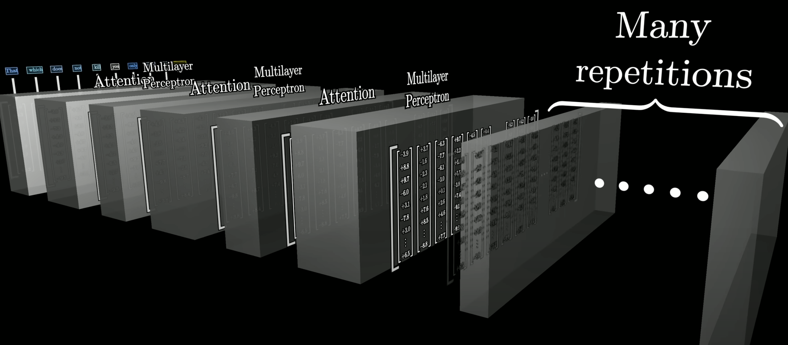
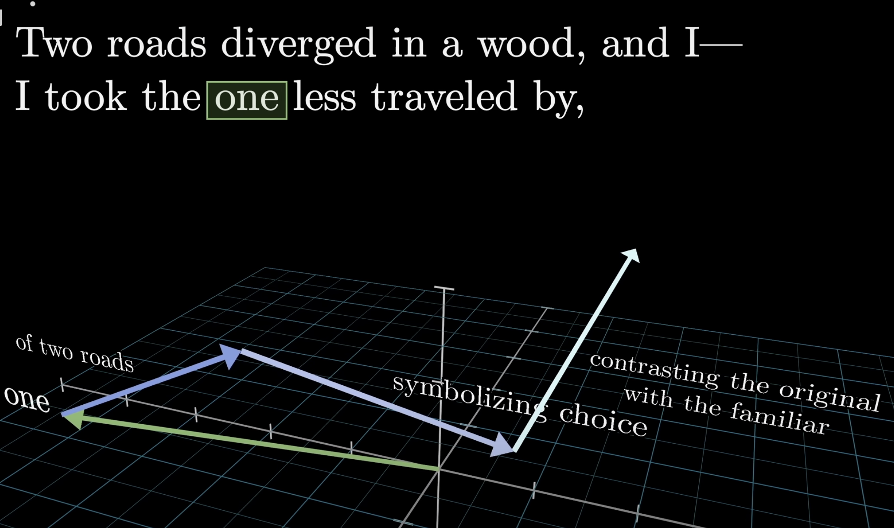
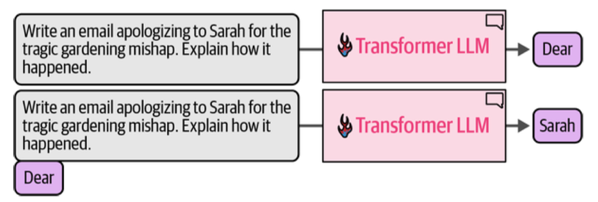
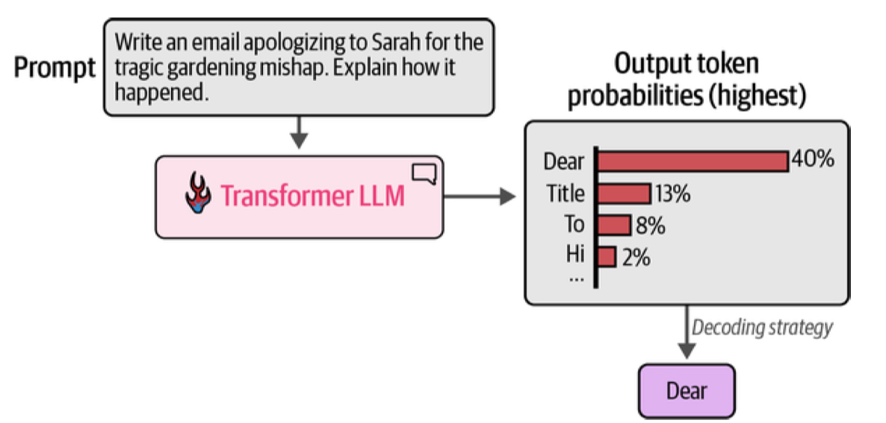

# The Brave New World of AI

Machine learning models have existed for a while, but recently there is a lot of excitement about lamguage models called generative models which generate text for user-specified tasks. These models are a form of model called a transformer-based model.

Large transformer-based models have revolutionized language modeling of all kinds. These models are called **Large Language Models** (LLMs).

A transformer model consists of multiple transformer blocks. Each transformer block has an **attention** part and a **memory** (or Multi-Layer Percepton) part. Its job is to take the original semantic meaning of a word and change it.

*The transformer is made up of a series of attention and memory blocks. Each block has a chance to affect the original word (image from 3blue1brown)*

The attention part captures concepts such as which words are related to each other, which sentences are related to each other, and so on and so forth within a document. It allows for the possibility that multiple words in a sentence may alter the meaning of a given word.

The memory part captures facts, such as the fact that Michael Jordan was an incredibly good basketball player, and that he played for the Chicago Bulls.

Together each block changes the original meaning of the word.

*each transformer block changes the original meaning of the word through the attention and memory process: here "one" gets attended to by "two roads" and a memory driven notion of 'symbolizing choice' in a Robert Frost poem. Subsequent transformer blocks change the meaning even more. (image from 3blue1brown)*

The interplay of these two parts allows us to take various aspects of a topic from the model's memory and relate them to each other in possibly unknown ways, thus mimicking intelligence. You have probably chatted with such a model, for example, Chatgpt or Claude, using a web-based interface where you write some text and the model responds.

The stuff you write to the model is what is called a **prompt**. Prompts can be much more sophisticated than what we usually write (indeed OpenAI sends some other stuff in a system and user prompt which it prepends to what you write). They can have multiple examples in them, they can have an exhortation to the model to reason step by step, they can have some reasoning steps put in by us to help the model along, stc. 

The maximum size of the prompt is what is called the **context** of the model. In general, you want to put into the context of this model stuff that is not there in the memory of the model. The attention mechanism will relate various parts of it to each other, and the memory lookup will help us draw in additional facts. 

Some models such as the new Qwen models from Alibaba and the Gemini models from google have
extremely large context sizes. Most models such as ChatGPT and Claude have a relatively small context size and so you might have found that when you chat with it it it tends to forget what's happening after a while. In general, you dont want to put too much in the prompt and thus in the context of the model: models do worse with irrelevant information.

But how does the model decide what to write back to you?

It does so in a very simple way, by trying to predict the next words in a sentence. And then
the next word...

 *We predict the next word in the sentence. Once we accept a new word, it is used with the original words to predict the next word. And so on and so forth. (image from Alammar et al)*

This is a probabilistic task, and each candidate word has a probability.
We'll usually choose the word with the highest probability, but if we want our model to be more
creative or to reason(more on this later in this series), you can choose a word with
lower probability.

*"Dear" has the highest probability. One strategy is to accept it. The other is to rendomly
sample a word based on its probability. So if we did this 100 times, in 40 of
those we'd choose "Dear", but in 13 we'd choose "Title". (image from Alammar et al)*

## Prompt Engineering

The art of constructing a prompt that helps you is what's called
prompt engineering. It is really more art than engineering and it's a lot of fun
to try and figure out. One of the key ways we try and work with this is to start
with the prompt, get an answer and see how far that answer is from the answer we
want. Based on this, we will rewrite the prompt to be something better. This is
called **prompt optimization**. This process is important in improving the performance of an AI model.
