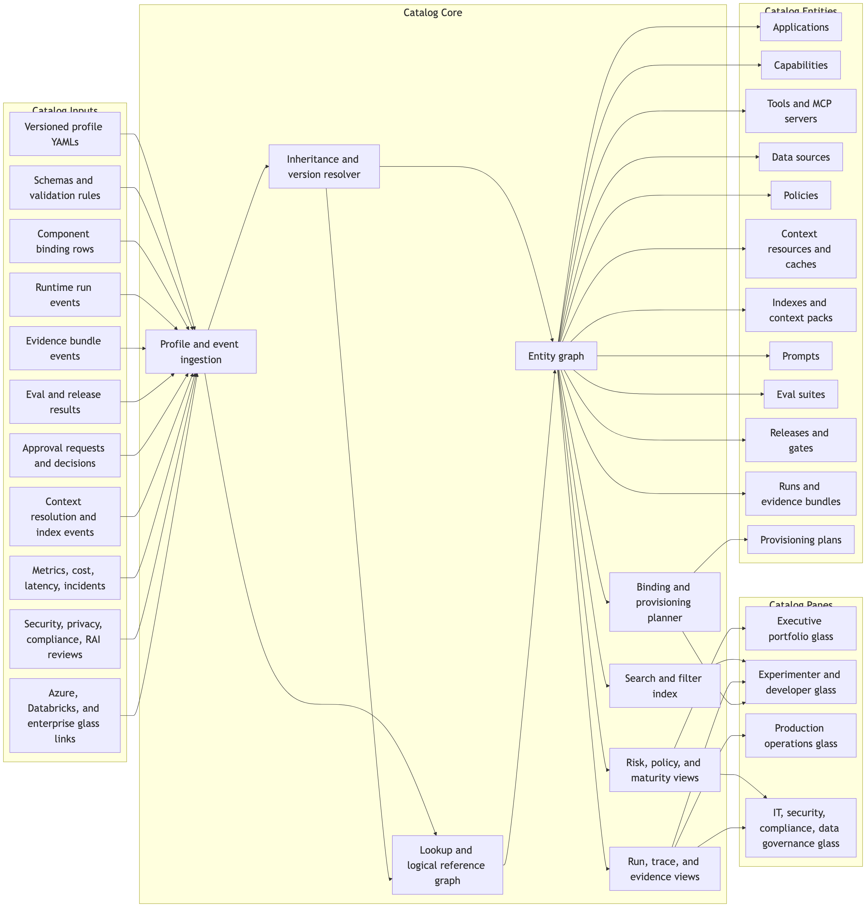
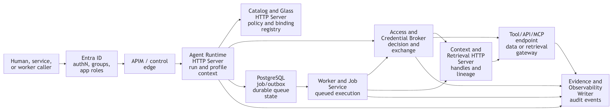
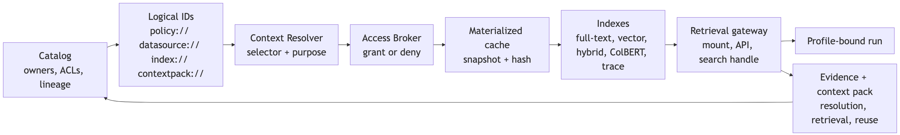
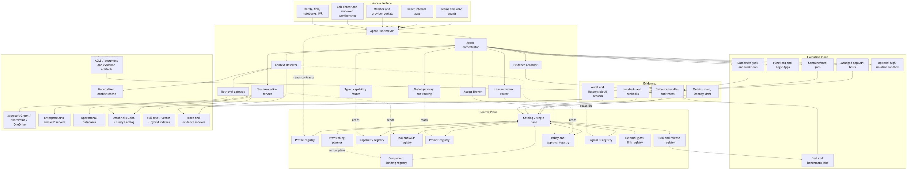
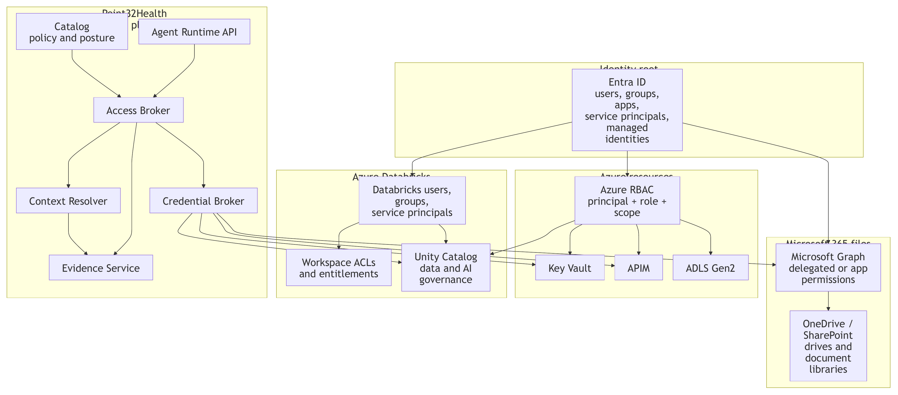
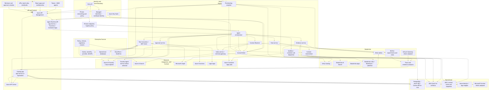

## Point32Health Agentic AI {.section-divider data-section="Opening" data-title="Point32Health Agentic AI Executive Briefing"}

[Executive briefing]{.eyebrow}

::: lead
Rahul Dave (Univ.Ai)
:::

::: lead
A governed platform approach to move from scattered pilots to safe, reusable enterprise capability.
:::

::: why-line
**How do we let adoption move quickly and co-operatively while security, compliance, evidence, humans in the loop, evals, and reuse are managed once?**
:::

::: notes
Open by positioning the deck as an operating-model briefing. The BBVA example comes next as the regulated-enterprise proof point before the Point32Health platform model.
:::

## BBVA escaped pilot purgatory by giving AI demand a managed path {data-section="Managed Adoption" data-title="BBVA Turned Shadow AI Into Managed Adoption"}

[Pre-story: regulated-bank example]{.eyebrow}

::: lead
The bank saw that employees were already using AI. The safer move was not to freeze demand; it was to channel it into a secure tool, a fast approval path, and a social adoption system that employees wanted to join.
:::

::: story-layout
::: {.story-panel .theme-catalog}
**A big-bank context, not a startup exception**

BBVA operated across 25 countries, served more than 77 million clients, employed about 125,000 workers, and worked under heavy regulation. Yet leaders compressed risk, legal, and compliance review into two months to avoid unmanaged shadow AI becoming the default.
:::

<strong>Shadow usage was the risk</strong>Unmanaged AI already existed, so doing nothing would have left leaders blind to data, usage, and quality.

<strong>Speed bypassed veto points</strong>The team moved before friction could accumulate, with a managed enterprise interface and bank-hosted services.

<strong>Status pulled adoption</strong>Scarce licenses, champions, and use-it-or-lose-it incentives made participation feel valuable rather than mandated.

<strong>Trust made sharing possible</strong>Prompt privacy, human ownership, quality scoring, and compliance-only access reduced resistance while keeping outputs accountable.

:::

::: source-line
Source: Garicano, Li & Wu, *Messy Jobs*, ch. 7, \"BBVA: escaping pilot purgatory\"; user-provided screenshots.
:::

::: notes
Use this as the executive hook: BBVA is useful because it is regulated, complex, and still moved quickly by managing adoption instead of letting local AI experiments harden invisibly.
:::

## Managed adoption beats pilot purgatory {data-section="Managed Adoption" data-title="Managed Adoption Beats Pilot Purgatory"}

[Pre-story: the lesson]{.eyebrow}

::: lead
Adoption, governance, peer learning, human ownership, and evidence moved together.
:::

<b>3k->11k</b>Active users scaled from roughly three thousand to eleven thousand.

<b>&gt;83%</b>Enterprise users worked with AI tools each week.

<b>4,800</b>Active internal GPTs were created by employees.

<b>99%</b>Auditors across countries became active AI users.

<b>3-4h</b>Estimated weekly time savings per auditor across more than 600 auditors.

::: {.callout .neutral}
For Point32Health, the lesson is: do not make governance a brake. Build the platform that lets safe adoption move quickly while evidence, standards, security, compliance, HITL, and evals are managed once.
:::

<strong>Profiles</strong> give autonomy a safe contract.

<strong>Catalog</strong> makes adoption and reuse visible.

<strong>Runtime</strong> keeps execution inside controls.

<strong>Evidence</strong> proves what happened and improves the next turn.

::: semantic-summary
How to read it: profile declares intent; catalog makes it visible; runtime executes it; evidence proves and improves it.
:::

::: source-line
Source: Garicano, Li & Wu, *Messy Jobs*, ch. 7, \"BBVA: escaping pilot purgatory\"; user-provided screenshots.
:::

::: notes
Transition to the next slide by saying: BBVA is the external proof that a managed platform can increase adoption and control together. The remaining deck translates that pattern into Point32Health\'s platform model.
:::

## Managed rollout creates the evidence base for governed reuse {data-section="Managed Adoption" data-title="Managed Rollout Builds Governed Evidence"}

[Bank adoption + managed path]{.eyebrow}

::: lead
BBVA shows why hidden demand needs a trusted path; the managed-adoption lesson is that useful work should happen where evidence, review, and reuse can be attached.
:::

<strong>Work happens</strong>Chats, products, harnesses, batch jobs, and reviews run through durable sessions.

<strong>Evidence remains</strong>Decisions, prompts, tool calls, approvals, evals, outputs, and lessons stay inspectable.

<strong>Patterns can graduate</strong>Good work can later become profiles, prompts, context packs, eval cases, and capabilities.

<strong>Reuse stays governed</strong>The catalog makes approved artifacts searchable, permissioned, reusable, and productized.

::: {.callout .neutral}
The goal is not a raw transcript archive. The goal is governed company memory: approved run residue that can become reusable assets without losing security, privacy, or owner control.
:::

::: source-line
Sources: `conceptspec.md`, `catalog.md`, `agent_harnesses.md`, `evals.md`
:::

::: notes
Use this early slide to connect the bank rollout story to managed adoption and evidence. Save the explicit River-like and AI-native organization point for the end.
:::

## The 13-document package is now a decision package {data-section="Package Story" data-title="The 13-Document Package Is A Decision Package"}

[Current package map]{.eyebrow}

::: lead
The planning package has grown from architecture description into a reviewable decision system: target architecture, implementation choices, profile contract, catalog product, security model, eval loop, future-practice stance, and SOW coverage.
:::

::: {.three-col .compact}
::: {.card .metric-card .theme-profile}
**Architecture contract**

Concept, implementation, profile, catalog, and identity/security documents define what every application must share.
:::

::: {.card .metric-card .theme-runtime}
**Build sequence**

Harness intake and trace capture come first, then trace-fed memory, then the Synthetic Benefits full app proof.
:::

::: {.card .metric-card .theme-evidence}
**Governance proof**

Evidence, evals, release gates, technology choices, future practices, and SOW traceability show how the package will be reviewed.
:::
:::

::: source-line
Sources: `readmefirst.md`, `Deliverables.md`, `sow_crosscut_traceability.md`
:::

::: notes
Use this as the update since the older deck: this is no longer only a concept deck. It is the executive map for a 13-source package with decisions, build sequence, and proof obligations.
:::

## Build the intake spine before the first full application proof {data-section="Package Story" data-title="Harness Intake Comes Before The Full App MVP"}

[Updated build sequence]{.eyebrow}

::: lead
The first platform proof is not the Synthetic Benefits application. The first proof is that approved agent work can be captured, reviewed in richer surfaces than chat, archived, normalized, evidenced, and turned into governed memory without broad credentials or PHI exposure.
:::

<strong>Thin intake spine</strong>Project, run, raw trace, canonical trace, evidence, agent-client, and instrumentation records.

<strong>Managed harness capture</strong>Codex and Claude Code-style sessions copied into raw evidence, review surfaces, and normalized traces.

<strong>Review and memory seed</strong>Specs, outputs, HTML artifacts, feedback, summaries, cache records, context-pack candidates, and simple indexes.

<strong>Synthetic Benefits MVP</strong>First full application proof using synthetic data, profile binding, broker, resolver, HITL, evals, and evidence.

<strong>Pilots and AI-native scale</strong>DAIS, payer pilots, shared capabilities, and tenant-scoped organizational memory.

::: {.callout .neutral}
This distinction matters: intake proves managed adoption; Synthetic Benefits proves the full application loop.
:::

::: source-line
Sources: `readmefirst.md`, `implspec.md` roadmap, `agent_harnesses.md`, `evals.md`
:::

## How An LLM Agent Run Works {.diagram-slide .title-hidden data-section="Agent Primer" data-title="How An LLM Agent Run Works"}

{.zoomable}

::: notes
Use this as the vocabulary primer before introducing the Point32Health platform model. The diagram intentionally keeps the terms generic: source, model turn, tool result, human-in-the-loop, eval or guardrail, and final answer.
:::

## Point32Health Needs A Platform {.hero-title data-section="Platform Case" data-title="Point32Health Needs A Platform"}

[Managed platform rationale]{.eyebrow}

::: why-line
**Because agentic AI only scales when evidence, reuse, cooperation, security, compliance, HITL, evals, user simplicity, and standards are managed once for every team.**
:::

<b>1</b><strong>Uniform Standards</strong>One operating contract across the enterprise.

<b>2</b><strong>Evidence Traces</strong>Durable records for runs, approvals, evals, and outcomes.

<b>3</b><strong>Reuse And Cooperation</strong>Shared capabilities and workflows compound across teams.

<b>4</b><strong>Security And Compliance</strong>Run-scoped access, PHI controls, signoff, and release gates.

<b>5</b><strong>HITL And Easy Evals</strong>Human review and quality checks become shared services.

<b>6</b><strong>User Simplicity And Future Readiness</strong>Users get protection while the platform absorbs technical change.

::: source-line
Sources: `securityspec.md`, `future_practices.md`, `catalog.md`
:::

::: notes
Use this slide as the map for the deck: the case is that managed platform behavior keeps agentic work governable, reusable, secure, and understandable across the enterprise.
:::

## Uniform Standards {.section-divider data-section="Platform Case" data-title="Axis 1: Uniform Standards"}

[Axis 1]{.eyebrow}

::: lead
The platform gives every agentic application the same contract for purpose, ownership, authority, evidence, evals, release state, and security posture.
:::

::: chip-row
[Profile contract]{.chip .theme-profile}[Catalog visibility]{.chip .theme-catalog}[Runtime enforcement]{.chip .theme-runtime}[Evidence proof layer]{.chip .theme-evidence}[Shared release gates]{.chip}
:::

## A governed enterprise platform for agentic AI work {.hero-title data-section="Platform Model" data-title="What This Project Is Trying To Build"}

[Point32Health agentic architecture]{.eyebrow}

::: hero-subtitle
The project is building the operating model and technical substrate for many agentic applications: visible, reusable, secure, auditable, and ready to move from prototype to controlled production.
:::

<strong>Profiles</strong>Declare purpose, owners, authority, data, tools, evidence, evals, release stage.

<strong>Catalog</strong>Shows complete portfolio, governance, risk, evidence, and operational state.

<strong>Runtime</strong>Executes profile-bound runs through brokered access and shared services.

<strong>Evidence</strong>Records what happened so work can be audited, evaluated, optimized, and reused.

::: semantic-summary
How to read it: profile declares intent; catalog makes it visible; runtime executes it; evidence proves and improves it.
:::

::: source-line
Sources: `conceptspec.md`, `catalog.md`, `implspec.md`
:::

::: notes
Open by making clear this is an internal enterprise platform initiative, not a vendor pitch or a single-app demo.
:::

## Agentic work will span the company; each team should not rebuild the control stack {data-section="Platform Model" data-title="Why Point32Health Needs A Common Approach"}

[Enterprise need]{.eyebrow}

::: three-col
::: {.card .metric-card style="--accent: var(--rose)"}
**Local bots create blind spots**

Executives and governance teams cannot see the full inventory, maturity, risk, cost, quality, and release posture.
:::

::: {.card .metric-card style="--accent: var(--amber)"}
**Controls get reimplemented**

Identity, data access, evidence, evals, approvals, prompt controls, and incident handling become inconsistent by app.
:::

::: {.card .metric-card style="--accent: var(--teal)"}
**Learning fails to compound**

Useful tools, retrievers, prompts, approval patterns, and evidence services mature locally but do not become reusable assets.
:::
:::

::: chip-row
[Benefits]{.chip}[Claims]{.chip}[Provider]{.chip}[Utilization management]{.chip}[Quality]{.chip}[Legal]{.chip}[Product]{.chip}[Operations]{.chip}
:::

::: notes
The message is not that local experimentation is bad. It is that enterprise scaling requires a common substrate before local experiments become production systems.
:::

## Profiles define the intent, catalog makes it shared, runtime enforces it, and evidence proves and improves it {data-section="Platform Model" data-title="The Core Idea: Profiles, Catalog, Runtime, Evidence"}

[Operating model]{.eyebrow}

::: core-cycle-layout

<strong>One managed platform loop</strong>Evidence is the proof and learning layer that improves each next turn.

<b>1</b><strong>Profile</strong>Purpose, owner, authority, data/tools, eval expectations, release stage, and risk posture.

<b>2</b><strong>Catalog</strong>Resolved contract visible across ownership, maturity, bindings, review surfaces, reuse, and release state.

<b>3</b><strong>Runtime</strong>Profile-bound runs broker access, resolve context, invoke tools, and route HITL feedback.

<b>4</b><strong>Evidence</strong>Trace, audit, review feedback, artifact archive, eval, compliance, and learning records.

declare<b>&rarr;</b>

publish controls<b>&rarr;</b>

write proof<b>&rarr;</b>

learn and gate<b>&rarr;</b>

::: {.aside-panel .theme-evidence}
### Why this matters

Business teams get speed without bypassing controls. Security and compliance get proof, not promises. Platform teams get reusable learning instead of one-off app telemetry.

<strong>Profile</strong> makes the promise explicit.

<strong>Catalog</strong> makes the promise shared.

<strong>Runtime</strong> makes the promise enforceable.

<strong>Evidence</strong> makes the promise auditable and improvable.

:::
:::

## A profile turns governance from prose into a reviewable application contract {data-section="Profile Contract" data-title="Profiles Make Governance Concrete"}

[Profile contract]{.eyebrow}

::: {.two-col .wide-left}
::: {.code-card .small}
    metadata:
      name: synthetic_benefits_navigator_app
      lifecycle_status: prototype
    inheritance:
      parent: enterprise_healthcare_agent_base
    surfaces:
      allowed_surface_types: [react_app, api, cli, teams, hitl_console]
    authority:
      default_level: L1_DRAFT
      prohibited_actions:
        - use_real_phi
        - perform_real_writeback
    data:
      data_classification: internal
    access:
      access_broker_required: true
      ambient_credentials_allowed: false
    evidence:
      bundle_required: true
    evals:
      release_gate_required: true
:::

::: lead
Application teams declare what is specific. The enterprise base profile supplies inherited controls for authority, access, sandboxing, evidence, evals, observability, release, and compliance.
:::

Maturity path

prototypeshadowassistivesupervised

::: {.callout .theme-profile}
Governance review can happen before deployment because the contract exists before the run.
:::

:::

## Executives review profile decisions, not schema fields {data-section="Profile Contract" data-title="Executives Review Profile Decisions"}

[Profile review]{.eyebrow}

::: lead
The YAML example matters because it turns abstract governance into visible decisions. The executive question is not "what is every field?" It is whether the declared contract is acceptable for the business, data, authority, and release stage.
:::

::: {.three-col .compact}
::: {.card .metric-card .theme-profile}
**Can this app exist?**

Owner, business purpose, users, surface, value hypothesis, maturity stage, and unresolved risks.
:::

::: {.card .metric-card .theme-runtime}
**Can it touch this data or tool?**

Allowed data class, logical source names, access mode, broker requirement, tool risk, sandbox boundary.
:::

::: {.card .metric-card .theme-evidence}
**Can it advance?**

Required evidence events, human approvals, eval suites, release gates, monitoring, rollback, and signoff.
:::
:::

::: {.callout .theme-profile}
The base profile carries enterprise defaults. A child profile should make exceptions and application-specific choices obvious enough to approve, reject, or send back.
:::

::: source-line
Source: `profilespec.md` catalog mapping and Synthetic Benefits overlay
:::

## Profiles make the control contract inspectable before an agent runs {.u-dense data-section="Profile Contract" data-title="Profile Fragments Show Different Guardrails"}

[Profile examples]{.eyebrow}

::: lead
Each child profile inherits enterprise defaults, then declares the few facts that change risk: surface, authority, data class, approval triggers, writeback posture, and catalog URLs.
:::

<strong>Benefits explanation</strong>Draft-only call-center assist
<pre>name: benefits_explanation_app
surface: call_center_console
authority: L1_DRAFT
data: phi_pii
source: datasource://point32health/benefits/prod/plan_documents
approval: formal_determination</pre>

<strong>Provider directory integrity</strong>Batch audit with review gates
<pre>name: provider_directory_integrity_app
surface: ops_dashboard, batch
authority: L2_RECOMMEND
data: confidential
source: datasource://point32health/providers/prod/directory
gate: provider_removal</pre>

<strong>Medical necessity review</strong>Reviewer assist, human decision
<pre>name: medical_necessity_review_app
surface: reviewer_workbench
authority: L2_RECOMMEND
data: highly_restricted
sandbox: deny_by_default
approval: adverse_determination</pre>

<strong>Claims exception resolution</strong>Pended-claim recommendation
<pre>name: claims_exception_resolution_app
surface: claims_workbench
authority: L2_RECOMMEND
data: highly_restricted
writeback: approval_required
gate: payment_or_denial_change</pre>

::: {.callout .neutral}
The profile names logical resources and policies; catalog binding records decide which concrete source, tool, model, prompt, index, or route is approved for the environment and release.
:::

::: source-line
Source: `profiles.md` application-profile examples
:::

## Business purpose, runtime shape, data bindings, and release evidence {.u-tight data-section="Profile Contract" data-title="Synthetic Benefits Shows The Profile Shape"}

[Profiles carry multi-purpose information]{.eyebrow}

::: lead
Here is the Synthetic Benefits profile. It is useful because it is safe, synthetic, and still exercises the real control contract leaders will review for production applications.
:::

<strong>Purpose and authority</strong>What the app may and may not do
<pre>metadata:
name: synthetic_benefits_navigator_app
display_name: Synthetic Benefits Navigator
inheritance:
parent: enterprise_healthcare_agent_base
authority:
default_level: L1_DRAFT
allowed_actions: [retrieve_context, call_tools, draft_response]
prohibited_actions: [use_real_phi, perform_real_writeback]</pre>

<strong>Runtime composition</strong>Lead agent plus reusable candidates
<pre>composition:
component_policy: single_lead_agent
components:
- synthetic_benefits_domain_agent
- synthetic_plan_document_retriever
- synthetic_eligibility_lookup
- synthetic_accumulator_lookup
- evidence_bundle_writer
- approval_router</pre>

<strong>Catalog-addressed data</strong>Logical URLs, not hidden source paths
<pre>data:
data_classification: internal
logical_reference_required: true
sources:
- logical_id: datasource://point32health/synthetic/dev/plan_documents
access_mode: retrieval
- logical_id: datasource://point32health/synthetic/dev/eligibility
access_mode: database_readonly
context_resources:
- index://point32health/synthetic/dev/plan_documents/fulltext?at=build:1</pre>

<strong>Review, evidence, and gates</strong>How the run becomes auditable
<pre>human_in_loop:
reviewer_roles: [demo_reviewer, benefits_sme]
escalation_triggers: [missing_plan_document, low_confidence]
evidence:
bundle_required: true
required_events: [run_created, access_decision, retrieval, tool_call, approval, eval_result]
evals:
release_gate_required: true
implementation_bindings:
prompt_registry_refs: [prompts/synthetic_benefits/domain_agent/v0.1]</pre>

::: {.callout .neutral}
This is why a profile is more than metadata: it binds intent, allowed behavior, catalog resources, review gates, evidence, and release readiness into one inspectable contract.
:::

::: source-line
Source: `profilespec.md` Synthetic Benefits overlay and resolved value view
:::

## The catalog is the control product for agentic AI work {data-section="Catalog Control" data-title="The Catalog Becomes The Enterprise Map"}

[Complete visibility]{.eyebrow}

::: {.two-col .wide-right}
::: {.aside-panel .theme-catalog}
### It answers the questions leaders, compliance, IT, and developers need

What exists? Who owns it? Which workflows does it touch? Which data, tools, models, prompts, and capabilities are used? What did it do? What risks remain? Is it safe to advance?

::: callout
The catalog is both a portfolio lens and an operating control surface.
:::
:::

::: {.diagram-frame .tall}
{.zoomable}
:::
:::

::: diagram-caption
Current figure from `conceptspec.pdf` / `conceptspec.md`
:::

## The catalog is operational, but it does not become a shadow admin portal {data-section="Catalog Control" data-title="Catalog Writes Through Owning Controls"}

[Operational glass]{.eyebrow}

::: lead
The catalog should let leaders and teams see posture and request change, but every material action still goes through the owning service, approval workflow, queued job, policy API, or provider driver.
:::

<table class="matrix" aria-label="Catalog operational control model">
<thead><tr><th>Action</th><th>What the catalog shows</th><th>How change happens</th></tr></thead>
<tbody>
<tr><td>Provision or bind</td><td>Selected binding, rejected options, risks, approvals, external glass links</td><td>Preview, approval, queued provisioning worker, Azure or Databricks driver</td></tr>
<tr><td>Access posture</td><td>Identity, policy, data class, TTL stance, access-decision evidence</td><td>Access/Credential Broker and provider IAM drivers</td></tr>
<tr><td>Context refresh</td><td>Snapshot, index build, freshness, lineage, retrieval evidence</td><td>Context Resolver plus materialization and indexing workers</td></tr>
<tr><td>Release gate</td><td>Eval results, human approvals, exceptions, rollback target</td><td>Eval/release control API and release workflow</td></tr>
</tbody>
</table>

::: {.callout .theme-catalog}
The catalog records intent, decisions, evidence, and job state. It should not bypass the owning runtime, broker, context, evidence, provisioning, or provider systems.
:::

::: source-line
Source: `catalog.md` Glass Read/Write Model
:::

## Catalog URLs are where controls attach {data-section="Catalog Control" data-title="Catalog URLs Are Where Controls Attach"}

[Catalog URL format]{.eyebrow}

::: lead
The same pattern names applications, agents, data sources, prompts, tools, evals, releases, runs, review surfaces, archived artifacts, and evidence trails. Applications use these handles; the catalog attaches the policy facts.
:::

::: url-pair
::: {.code-card .url-card}
[Dev examples]{.code-label}

    app://point32health/member/dev/benefits_explanation
    capability://point32health/benefits/dev/domain_agent
    datasource://point32health/synthetic/dev/plan_documents
    prompt://point32health/benefits/dev/domain_agent/default?at=stage:draft
    eval://point32health/benefits/dev/smoke/v1
    review://point32health/benefits/dev/run_abc123/spec-review
:::

::: {.code-card .url-card}
[Prod examples]{.code-label}

    app://point32health/member/prod/benefits_explanation
    datasource://point32health/benefits/prod/plan_documents?at=snapshot:2026-06-01
    prompt://point32health/benefits/prod/domain_agent/default?at=stage:approved
    release://point32health/benefits/prod/benefits_explanation/2026_06
    trace://point32health/benefits/prod/run_abc123/evidence
    artifact://point32health/benefits/prod/run_abc123/html/verification-site
:::
:::

::: {.four-col .compact}
::: {.card .theme-catalog}
**URL handle**

Stable catalog object the application can pass.
:::

::: card
**Time-bound permission**

Who can use it, for what purpose, scope, and duration.
:::

::: {.card .theme-runtime}
**Runtime binding**

Which source, route, index, model, or tool endpoint is approved.
:::

::: {.card .theme-evidence}
**Evidence gate**

Eval, review, archive, approval, release, rollback, and recording requirements.
:::
:::

::: {.callout .neutral}
Broker rule: compose the grants needed for the run, then narrow each one by every attached constraint: app/profile, agent, datasource, prompt, tool, eval, release, purpose, scope, expiry, and approval state.
:::

::: source-line
Sources: `catalog.md` Universal Logical References, `securityspec.md` Access Envelope
:::

::: notes
The key point is that the catalog URL is the stable attachment point. Permissions are not broad app-level permission blobs; the broker composes required grants and every relevant catalog object can narrow or deny the run.
:::

## Runtime turns intent into governed execution {data-section="Runtime Control" data-title="Runtime Turns Intent Into A Governed Run"}

[Runtime plane]{.eyebrow}

::: lead
Executives do not need container details, but they do need to know what every run recomputes: access, approved context, model/tool use, human review, and evidence.
:::

<strong>Resolve profile</strong>Confirm owner, purpose, authority, release state, and allowed surfaces.

<strong>Compute access</strong>Broker builds required grants, then narrows them by scope, expiry, approval, and policy.

<strong>Resolve context</strong>Turn catalog URLs into approved snapshots, caches, indexes, and retrieval handles.

<strong>Execute safely</strong>Invoke model routes, tools, capabilities, HITL steps, and kill-switch rules.

<strong>Write evidence</strong>Record access, context, calls, outputs, evals, approvals, incidents, and metrics.

::: {.callout .neutral}
Runtime gives speed without ambient authority: agents get scoped handles and approved context, not broad credentials or unmanaged source paths.
:::

::: source-line
Sources: `implspec.md` runtime/access/context sections, `securityspec.md` Access Envelope
:::

::: notes
Use this to make runtime concrete for executives: it is the place where profile and catalog intent become per-run decisions, not just infrastructure hosting.
:::

## Executives see the agentic portfolio as a managed operating system, not scattered demos {data-section="Catalog Control" data-title="Executives Get Portfolio Visibility"}

[Leadership visibility]{.eyebrow} 

<b>Inventory</b>Applications, capabilities, tools, data sources, owners, and maturity stages.

<b>Value</b>Expected value, adoption, active users, run volume, quality, and cost trend.

<b>Risk</b>PHI/PII exposure, authority level, writeback posture, vendor/model usage, open exceptions.

<b>Readiness</b>Eval status, approval state, release gate, incidents, rollback path, and security signoff.

 <table class="matrix" aria-label="Catalog panes">
<thead><tr><th>Pane</th><th>Primary question</th><th>Example signal</th></tr></thead>
<tbody>
<tr><td>Executive</td><td>Is this agentic work valuable and safe to scale?</td><td>Maturity, risk, adoption, cost, release posture</td></tr>
<tr><td>Operations</td><td>What is live, what is failing, and what can be rolled back?</td><td>Latency, failures, incidents, kill switches</td></tr>
<tr><td>Security and compliance</td><td>Is this allowed to run with this data and authority?</td><td>Policy, identity, PHI, evidence, signoff</td></tr>
</tbody>
</table>

## Anatomy Of An AI Application {.diagram-slide .title-hidden data-section="Platform Vocabulary" data-title="Anatomy Of An AI Application"}

{.zoomable}

::: notes
Use this as the close of Axis 1: the point is shared vocabulary. The same four semantic colors carry forward through the deck: profile, catalog, runtime, and evidence.
:::

## Evidence Traces {.section-divider data-section="Evidence" data-title="Axis 2: Evidence Traces"}

[Axis 2]{.eyebrow}

::: lead
Runs, access decisions, retrieved context, model/tool calls, approvals, evals, incidents, and release gates become a durable trail that leaders, operators, security, compliance, and auditors can inspect.
:::

::: chip-row
[Auditability]{.chip .theme-evidence}[Debugging]{.chip .theme-evidence}[Replay]{.chip .theme-evidence}[Regression tests]{.chip .theme-evidence}[Release signoff]{.chip .theme-evidence}
:::

## Every important run should leave a durable, navigable evidence trail {data-section="Evidence" data-title="Evidence Turns Agent Work Into Auditable Work"}

[Auditability]{.eyebrow} 

<strong>Profile resolved</strong>App version, inherited controls, release state.

<strong>Access decided</strong>Broker policy, scope, expiry, approval requirement.

<strong>Context used</strong>Source snapshot, cache, index, retrieval event, citation.

<strong>Action recorded</strong>Model call, tool call, sandbox event, output artifact.

<strong>Gate applied</strong>Approval, eval result, release decision, exception.

::: {.callout .theme-evidence}
Evidence supports audit, compliance, debugging, replay, regression tests, release gates, prompt optimization, RL-style learning, and executive visibility into risk and quality.
:::

## Evals turn captured work into release decisions {data-section="Evidence And Evals" data-title="Evals Turn Traces Into Release Decisions"}

[Trace-based evaluation]{.eyebrow}

::: lead
Evaluation is not a detached scorecard. It is the loop that turns real traces, human critique, known risks, and release candidates into a visible pass/fail decision.
:::

<strong>Inspect traces</strong>Prompts, context, citations, tools, approvals, outputs, costs, and failures.

<strong>Name criteria</strong>Domain experts convert critiques into owned criteria, cases, and review queues.

<strong>Run checks</strong>Local evals, Foundry evals, safety checks, citation checks, and calibrated judges.

<strong>Compare baseline</strong>Candidate release versus approved baseline, with row-level failures visible.

<strong>Gate release</strong>Safety, privacy, access, compliance, and critical quality failures can veto promotion.

::: {.callout .neutral}
The first eval proof should test harness intake itself before Synthetic Benefits carries the first application-specific eval suite.
:::

::: source-line
Source: `evals.md` release gates and prototype path
:::

## Reuse And Cooperation {.section-divider data-section="Reuse" data-title="Axis 3: Reuse And Cooperation"}

[Axis 3]{.eyebrow}

::: lead
The architecture lets teams share capabilities, context packs, approval patterns, evals, evidence services, and integration bindings while still preserving local workflow ownership.
:::

::: chip-row
[Shared capabilities]{.chip}[Typed contracts]{.chip}[Context packs]{.chip}[Owner-visible reuse]{.chip}
:::

## Application teams focus on workflows while shared services handle enterprise obligations {data-section="Reuse" data-title="Business Teams Get Faster, Safer Delivery"}

[Delivery benefit]{.eyebrow}

::: three-col
::: {.card .metric-card .theme-runtime}
**Reusable runtime**

Run creation, durable state, tool calls, model routing, approvals, broker handoffs, and kill switches become common services.
:::

::: {.card .metric-card .theme-profile}
**Reusable governance**

Profile inheritance carries enterprise controls into each application without making teams restate every rule.
:::

::: {.card .metric-card .theme-catalog}
**Reusable integration**

Catalog bindings connect profile intent to Azure, Databricks, APIM, Graph, Search, Key Vault, and enterprise APIs.
:::
:::

::: callout
The platform should lower delivery friction and raise the control baseline at the same time.
:::

## Useful app-local work can graduate into shared enterprise capabilities {data-section="Reuse" data-title="Capabilities Can Be Reused Across Use Cases"}

[Reuse]{.eyebrow} 

<strong>Local component</strong>Built inside one app to prove a workflow.

<strong>Reuse candidate</strong>Another app needs the same pattern or service.

<strong>Typed capability</strong>Input/output contract, owner, allowed callers, evals, evidence.

<strong>Shared release</strong>Versioned, monitored, reviewed, and bound through the catalog.

<strong>Platform primitive</strong>Multiple consumers, runbooks, cost/quality/risk visibility.

::: chip-row
[Evidence writer]{.chip .theme-evidence}[Approval router]{.chip .theme-runtime}[Retrieval with provenance]{.chip .theme-catalog}[Document understanding]{.chip}[Provider lookup]{.chip}[Claims explanation]{.chip}[Context resolver]{.chip .theme-catalog}
:::

## Security And Compliance {.section-divider data-section="Security" data-title="Axis 4: Security And Compliance"}

[Axis 4]{.eyebrow}

::: lead
The security design composes Entra, RBAC, Databricks, profile policy, purpose, data classification, approval state, environment, release state, and evidence before access is granted.
:::

::: chip-row
[Run-scoped identity]{.chip}[Short-lived handles]{.chip}[Prompt/tool guardrails]{.chip}[Compliance signoff]{.chip}
:::

## Entra ID and RBAC remain foundational, but agent access is decided per run {data-section="Security" data-title="Security Improves Because Access Is Run-Scoped"}

[Security benefit]{.eyebrow} 

<strong>Identity</strong>Human, app, service principal, managed identity, group, surface.

<strong>Profile</strong>Application, capability, authority, data class, allowed tool.

<strong>Purpose</strong>Task, environment, maturity, release, approval state.

<strong>Decision</strong>Grant, deny, narrow scope, or require approval.

<strong>Evidence</strong>Record decision, exchange, retrieval, tool call, output, approval.

::: callout
The platform adds profile-aware access policy above identity and RBAC facts, so a user or service account cannot silently hand broad authority to an agent.
:::

## The broker gives agents bounded handles, not reusable enterprise credentials {data-section="Security" data-title="Agents Do Not Receive Broad Credentials"}

[Credential boundary]{.eyebrow}

::: {.diagram-frame .strip .security-strip}
{.zoomable}
:::

::: diagram-caption
Current figure from `securityspec.pdf` / `securityspec.md`
:::

::: {.four-col .compact}
::: card
**Short lived**

Tokens, handles, snapshots, or sessions expire and can be revoked.
:::

::: {.card .theme-profile}
**Purpose bound**

Access is tied to profile, task, source, operation, and release state.
:::

::: card
**Server side**

Secrets remain in broker, Key Vault, APIM, managed identity, or source systems.
:::

::: {.card .theme-evidence}
**Audited**

Every decision and exchange becomes evidence for review.
:::
:::

## Healthcare-specific risks are designed into the platform rather than patched onto apps {data-section="Security" data-title="PHI, Prompt Injection, And Tool Risk Are First-Class Controls"}

[Healthcare guardrails]{.eyebrow}

::: three-col
::: {.card .metric-card style="--accent: var(--rose)"}
**Data minimization**

Retrieve the minimum necessary context at the approved redaction level before model calls.
:::

::: {.card .metric-card style="--accent: var(--amber)"}
**Prompt and tool injection**

Treat retrieved content as data, gate tools, label source trust, and test injection/exfiltration paths.
:::

::: {.card .metric-card style="--accent: var(--violet)"}
**Human review**

High-impact clinical, financial, adverse, external, or writeback actions require role-qualified approval.
:::
:::

<table class="matrix">
<thead><tr><th>Risk</th><th>Platform control</th></tr></thead>
<tbody>
<tr><td>PHI/PII overexposure</td><td>Data classification, minimum necessary retrieval, redaction, evidence retention policy</td></tr>
<tr><td>Unauthorized tool use</td><td>Tool registry, APIM/MCP gateway, Access Broker, approval gates</td></tr>
<tr><td>Unsafe promotion</td><td>Evals, red-team tests, release gates, security signoff, rollback path</td></tr>
</tbody>
</table>

## A release is not production-ready until evidence, owners, exceptions, and rollback are visible {data-section="Security" data-title="Compliance Signoff Is Tied To Release State"}

[Compliance and signoff]{.eyebrow}

::: three-col
::: {.card .metric-card .theme-evidence}
**Evidence completeness**

Profile, release, access, credential exchange, guardrails, evals, approvals, and exceptions must be present.
:::

::: {.card .metric-card style="--accent: var(--amber)"}
**Required reviewers**

Product, data, IT/IAM, security, compliance, privacy, RAI, operations, and accountable executives approve bounded areas.
:::

::: {.card .metric-card style="--accent: var(--rose)"}
**Fail-closed gate**

Missing evidence, unresolved high-risk findings, unclear PHI reuse, or unowned exceptions block promotion.
:::
:::

::: callout
Executive approval is additive: it accepts enterprise accountability, but it does not override missing data, security, compliance, tool, or production approval.
:::

## Shared release gates mean every app follows the same controlled path to production {data-section="Release Gates" data-title="Shared Release Gates Mean One Promotion Path"}

[Dev to production]{.eyebrow}

::: lead
A release gate is the common promotion checkpoint between environments. It lets different teams move quickly, but only after the catalog shows the right owner, bindings, evals, approvals, evidence, monitoring, and rollback plan for that stage.
:::

<h3>Dev</h3>

Prototype with synthetic or non-production paths. Prove the profile, logical IDs, baseline evals, and evidence events work.

<code>/dev/</code>

<h3>Staging</h3>

Exercise production-like bindings, reviewers, guardrails, runbooks, and failure modes before a wider audience sees the workflow.

<code>/staging/</code>

<h3>Production</h3>

Run only the approved release version, with catalog-visible owners, access, monitoring, incident response, and rollback.

<code>/prod/</code>

::: promotion-rule
The gate is shared because the platform owns the promotion rule once; each application supplies its own evidence, approvals, and environment-specific bindings.
:::

::: source-line
Sources: `catalog.md` release page, governance workflows, maturity states
:::

::: notes
Use this to explain why shared release gates are not another committee. The point is a common dev-to-prod control path: each app has its own facts and risks, but the promotion rule, evidence expectations, and catalog record are standardized.
:::

## HITL And Easy Evals {.section-divider data-section="Evals And HITL" data-title="Axis 5: HITL And Easy Evals"}

[Axis 5]{.eyebrow}

::: lead
The platform separates draft work from high-impact action, captures reviewer decisions as evidence, and turns known failures into reusable eval and release-gate assets.
:::

::: chip-row
[Approval routing]{.chip}[Golden sets]{.chip}[Regression cases]{.chip}[Safety tests]{.chip}[Reviewer feedback]{.chip}
:::

## High-impact actions stay human-approved while routine quality checks get easier to reuse {data-section="Evals And HITL" data-title="HITL And Evals Become Shared Platform Services"}

[HITL and evals]{.eyebrow}

::: two-col
::: aside-panel
### Human-in-the-loop

Clinical, financial, adverse-action, external communication, source-system writeback, and material exception paths route to role-qualified reviewers before action.

::: {.callout .theme-evidence}
Reviewer decisions become evidence, not informal comments lost outside the system.
:::
:::

::: {.aside-panel .theme-evidence}
### Evaluation loop

Golden sets, citation checks, prompt/tool-injection tests, PHI leakage checks, red-team scans, and reviewer feedback become reusable release-gate material.

::: callout
Teams can improve quality without inventing a new eval harness for every app.
:::
:::
:::

## Review surfaces turn agent work into governed artifacts {data-section="Evals And HITL" data-title="Review Surfaces Turn Agent Work Into Governed Artifacts"}

[Richer human feedback]{.eyebrow}

::: lead
When chat is too narrow, the catalog gives reviewers a real surface: a spec with inline comments, an output draft with citations, a static HTML explanation, a browser-test replay, or a temporary live app.
:::

::: {.four-col .compact}
::: {.card .theme-catalog}
**Catalog endpoint**

Humans open `app://...`, not raw local ports or unmanaged share links.
:::

::: {.card .theme-runtime}
**HITL packet**

Runtime controls reviewer actions, TTLs, kill switches, and agent messages.
:::

::: {.card .theme-evidence}
**Feedback evidence**

Comments, suggestions, decisions, and accepted edits become `reviewevent://...`.
:::

::: card
**Artifact archive**

Source, rendered view, feedback, screenshot, and logs stay under `artifact://...`.
:::
:::

::: source-line
Sources: `catalog.md`, `implspec.md` Section 13, `securityspec.md` review-surface controls
:::

## User Simplicity And Future Readiness {.section-divider data-section="Future Readiness" data-title="Axis 6: User Simplicity And Future Readiness"}

[Axis 6]{.eyebrow}

::: lead
Stable profiles, catalog records, runtime APIs, evidence bundles, and release gates let Point32Health adopt new agent frameworks, memory, subagents, optimization, and RL patterns without changing the business-facing contract.
:::

::: chip-row
[No technical burden on users]{.chip}[Swappable implementations]{.chip .theme-runtime}[Future practices]{.chip}[Controlled adoption]{.chip .theme-catalog}
:::

## New agent patterns should be adopted through experiments, not one-off production shortcuts {data-section="Future Readiness" data-title="Future Practices Plug Into The Same Control Model"}

[Future work]{.eyebrow}

::: {.three-col .compact}
::: {.card .metric-card style="--accent: var(--violet)"}
**Subagents**

Use bounded delegation, typed capabilities, context packets, budget limits, and parent/child evidence.
:::

::: {.card .metric-card .theme-catalog}
**Memory**

Start with hybrid retrieval, context packs, key-file packs, and trace-derived memory only after redaction and approval.
:::

::: {.card .metric-card .theme-evidence}
**Optimization**

Run prompt/program optimization and RL-style learning offline against approved benchmarks and release gates.
:::

::: {.card .metric-card style="--accent: var(--amber)"}
**Compaction**

Treat summaries as derivative artifacts with source links, validation, warnings, retention, and reuse policy.
:::

::: {.card .metric-card .theme-catalog}
**Managed platforms**

Use Azure, Databricks, OpenAI, or future services where they fit, then mirror traces into the catalog.
:::

::: {.card .metric-card .theme-evidence}
**Governed feedback**

Trace reuse, eval corpora, optimizer inputs, and learning datasets need classification and approval.
:::
:::

::: source-line
Source: `future_practices.md`
:::

## The default implementation stack is Azure where Azure is the enterprise control point {.u-dense data-section="Technology Choices" data-title="Default Software Choices Are Azure-First"}

[Software choices]{.eyebrow}

::: lead
The software plan turns the platform model into concrete defaults: use Azure for enterprise application surfaces, identity, API control, managed hosting, monitoring, search, owned operational state, and model governance where it fits.
:::

<table class="matrix choice-table" aria-label="Azure-first software choices">
<thead>
<tr><th>Kind</th><th>Software to use</th><th>Azure?</th></tr>
</thead>
<tbody>
<tr><td>Catalog and profile registry</td><td>Azure App Service or equivalent, PostgreSQL or Azure SQL, Entra ID, and imports from Databricks.</td><td>Yes</td></tr>
<tr><td>Agent Runtime API</td><td>Point32Health Runtime API on App Service or Functions behind APIM, with canonical evidence hooks.</td><td>Yes</td></tr>
<tr><td>Managed agents and LLMs</td><td>Azure AI Foundry Agent Service, Foundry model catalog, and Azure OpenAI as the Azure-managed default.</td><td>Yes</td></tr>
<tr><td>Model, tool, API, and MCP gateway</td><td>Azure API Management AI gateway, API Center, Azure Functions, and App Service MCP endpoints.</td><td>Yes</td></tr>
<tr><td>Identity, access, and secrets</td><td>Entra ID, managed identities, Azure RBAC, Key Vault, and APIM credential manager.</td><td>Yes</td></tr>
<tr><td>Enterprise retrieval</td><td>Azure AI Search for enterprise application retrieval, vector, hybrid, and full-text search.</td><td>Yes</td></tr>
<tr><td>Hosting, jobs, and sandboxes</td><td>App Service, Functions, Logic Apps, and Container Apps for APIs, integration jobs, and selected sandbox jobs.</td><td>Yes</td></tr>
<tr><td>Evidence, traces, and artifacts</td><td>PostgreSQL or Azure SQL for metadata, ADLS or Blob for artifacts, Azure Monitor and App Insights for operations.</td><td>Yes</td></tr>
</tbody>
</table>

::: source-line
Source: `implspec.md` Section 23 software-choice appendix
:::

## Databricks and external tools are deliberate exceptions, not the default control plane {.u-dense data-section="Technology Choices" data-title="Databricks And External Choices Stay Bounded"}

[Software choices]{.eyebrow}

::: lead
Use Databricks where the work is lakehouse-native or data/ML-centered. Use external tools only as pressure valves after native Azure and Databricks options are mapped.
:::

<table class="matrix choice-table" aria-label="Databricks and non-Azure software choices">
<thead>
<tr><th>Kind</th><th>Software to use</th><th>Azure?</th></tr>
</thead>
<tbody>
<tr><td>Lakehouse governance</td><td>Databricks Unity Catalog and Unity AI Gateway for Databricks data, model, MCP, and usage governance.</td><td>No</td></tr>
<tr><td>Data-side tools and MCP</td><td>Databricks MCP, Genie, SQL, notebooks, and custom Databricks-side tools where governed data lives there.</td><td>No</td></tr>
<tr><td>Data and ML pipelines</td><td>Databricks Jobs, Workflows, Lakeflow, Delta, and Runtime API handoff at the agent boundary.</td><td>No</td></tr>
<tr><td>Data-side model serving and evals</td><td>Databricks Model Serving, MLflow 3, Delta, and Unity Catalog for classifiers, experiments, and data-side agents.</td><td>No</td></tr>
<tr><td>Delta-native retrieval and analytics</td><td>Databricks AI Search plus Delta trace, evidence, eval, and cost mirrors for lakehouse analysis.</td><td>No</td></tr>
<tr><td>Prompt, eval, and trace pressure valves</td><td>LangSmith, Braintrust, Arize Phoenix, OpenTelemetry collectors, or similar only for validated gaps.</td><td>No</td></tr>
<tr><td>Workflow pressure valves</td><td>Temporal, Prefect, Dagster, or Airflow only when Azure and Databricks basics are not enough.</td><td>No</td></tr>
<tr><td>Specialized parsers and AI security</td><td>Docling, LlamaParse, HiddenLayer, Lakera, Protect AI, or similar after document/security gap review.</td><td>No</td></tr>
</tbody>
</table>

::: source-line
Source: `implspec.md` Section 23 software-choice appendix
:::

## Synthetic Benefits is the first full application proof, after intake works {data-section="Roadmap" data-title="Synthetic Benefits Is The First Full App Proof"}

[Prototype proof]{.eyebrow}

::: lead
Synthetic Benefits remains the right first full application MVP because it is safe, synthetic, and still exercises the real control contract. It should come after the intake spine can already name, capture, normalize, and evidence managed agent work.
:::

::: two-col
::: aside-panel
### Prototype question

Is physical therapy covered for this synthetic member, and what would they likely pay if they use this provider?

::: chip-row
[Synthetic plan docs]{.chip}[Eligibility table]{.chip}[Accumulator table]{.chip}[Provider directory]{.chip}[Benefit config]{.chip}
:::
:::

<strong>Profile</strong>Allowed surfaces, inherited controls, synthetic data, prohibited actions, evidence, and evals.

<strong>Catalog</strong>Application page, profile lineage, logical IDs, binding preview, run timeline, approval, eval, and metrics.

<strong>Runtime</strong>Resolve profile, broker synthetic access, resolve context, call tools, compose answer, and route approval.

<strong>Evidence</strong>Capture access, context, retrieval, tool calls, output, approval, evals, citations, and improvement candidates.

:::

::: {.callout .neutral}
The proof value is not the benefits question itself. The proof value is that the full governed loop works before real PHI or source-system writeback.
:::

::: source-line
Sources: `prototype.md`, `profilespec.md`, `catalog.md`, `evals.md`
:::

## The roadmap starts with managed adoption, not production automation {data-section="Roadmap" data-title="Updated Roadmap Starts With Managed Adoption"}

[Updated roadmap]{.eyebrow}

<strong>1. Intake spine</strong>Minimal catalog/project/run IDs, agent-client records, profile binding, evidence writing, and trace storage.

<strong>2. Harness MVP</strong>Codex and Claude Code-style sessions captured through managed launch context, hooks, telemetry, and normalizers.

<strong>3. Review and memory seed</strong>Spec/output review surfaces, archived artifacts, project memory files, trace summaries, context-pack candidates, and simple indexes.

<strong>4. Synthetic Benefits</strong>First full app MVP with broker, resolver, HITL, evals, observability, and synthetic data.

<strong>5. Pilots and capabilities</strong>DAIS, benefits, provider, claims, HEDIS, and reusable platform capabilities.

<strong>6. AI-native scale</strong>Tenant-scoped memory across Teams, Excel, OneDrive, Databricks, apps, and project spaces.

::: callout
Maturity states stay explicit in the catalog: proposed, design, prototype, shadow, assistive, supervised action, limited automation, and scaled automation.
:::

::: source-line
Sources: `readmefirst.md`, `implspec.md` roadmap, `catalog.md` maturity states
:::

## The next decisions are about ownership, gates, and sequence {data-section="Executive Decisions" data-title="Executive Decisions To Close"}

[Executive alignment]{.eyebrow}

::: lead
The technology stack is now specific enough to review. The open executive questions are mostly operating-model questions: who owns the shared control product, which gates are mandatory, and which use cases move after the intake proof.
:::

::: {.two-col .compact}
::: card
**Confirm the catalog as the control product**

Inventory, approvals, release state, evidence, security posture, and external glass links should converge there.
:::

::: card
**Name accountable owners**

Business, platform, security, compliance, data governance, operations, and reusable capability ownership must be visible.
:::

::: card
**Approve the staged gates**

Harness intake, Synthetic Benefits, controlled pilots, production hardening, and AI-native expansion each need different evidence.
:::

::: card
**Choose the first pilot lane**

After Synthetic Benefits proves the full loop, choose DAIS or a payer pilot based on value, risk, data readiness, and reviewer capacity.
:::
:::

::: callout
The executive value is fast managed adoption, reusable platform capability, and stronger security/compliance posture, not simply more AI usage.
:::

## A River-like operating model turns managed work into governed memory {data-section="Operating Model" data-title="River-Like Operating Model"}

[AI-native operating model]{.eyebrow}

::: lead
The long-term goal is not a chatbot on every screen. It is work that becomes capturable, searchable, reusable, and governed inside the right tenant-like boundary.
:::

<strong>Work runs</strong>Teams, Excel, apps, notebooks, harnesses, batch jobs, and reviews call the shared runtime envelope.

<strong>Evidence remains</strong>Prompts, decisions, tool calls, approvals, evals, outputs, and exceptions stay inspectable.

<strong>Memory is promoted</strong>Approved residue becomes prompts, context packs, capabilities, eval cases, runbooks, and release evidence.

<strong>Reuse stays bounded</strong>Tenant scope, identity, classification, redaction, retention, owner approval, and release gates decide reuse.

::: {.callout .neutral}
Point32Health becomes AI-native when the next team can start from approved prior work without flattening privacy, security, compliance, or ownership boundaries.
:::

::: source-line
Sources: `riverness.md`, `agent_harnesses.md`, `catalog.md`, `evals.md`
:::

::: notes
Use this as the end-of-deck operating-model slide. It normalizes the River-like idea into healthcare-grade tenant-scoped sharing and governed company memory.
:::
## Five surrounding platform planes and the governed runtime {data-kind="appendix" data-section="Appendix" data-title="Appendix: Five-Plane Architecture"}

[Appendix figure]{.eyebrow}

::: {.diagram-frame .tall}
{.zoomable}
:::

::: diagram-caption
Current figure from `conceptspec.pdf`
:::

## Logical references keep context stable while backing stores change {data-kind="appendix" data-section="Appendix" data-title="Appendix: Logical Context Resolver"}

[Appendix figure]{.eyebrow}

::: {.diagram-frame .strip}
{.zoomable}
:::

::: callout
Catalog-owned logical IDs such as `policy://`, `datasource://`, `index://`, and `contextpack://` resolve into approved snapshots, caches, indexes, retrieval handles, and evidence.
:::

## Identity and authorization layers compose under the broker {data-kind="appendix" data-section="Appendix" data-title="Appendix: Identity Layers"}

[Appendix figure]{.eyebrow}

::: {.diagram-frame .tall}
{.zoomable}
:::

::: diagram-caption
Current figure from `identity_auth_layers.pdf`
:::

## Example profile excerpt: Synthetic Benefits Navigator {data-kind="appendix" data-section="Appendix" data-title="Appendix: Synthetic Benefits Profile Excerpt"}

[Appendix YAML]{.eyebrow}

::: code-card
    metadata:
      name: synthetic_benefits_navigator_app
      lifecycle_status: prototype
    inheritance:
      parent: enterprise_healthcare_agent_base
    business:
      domain: member
      business_metrics: [answer_accuracy, citation_fidelity, approval_flow_success, eval_pass_rate]
    surfaces:
      allowed_surface_types: [react_app, api, cli, teams, hitl_console]
    authority:
      default_level: L1_DRAFT
      prohibited_actions: [use_real_phi, use_real_member_data, perform_real_writeback]
    data:
      data_classification: internal
      sources:
        - name: synthetic_plan_documents
          logical_id: datasource://point32health/synthetic/dev/plan_documents
        - name: synthetic_accumulators
          logical_id: datasource://point32health/synthetic/dev/accumulators
    evidence:
      required_events: [run_created, profile_resolved, access_decision, context_resolved,
        retrieval, tool_call, model_call, output_artifact, approval, eval_result]
:::

::: source-line
Excerpted from `profiles.md` and `profilespec.md`
:::

## Azure-first implementation with Databricks where data and ML live {data-kind="appendix" data-section="Appendix" data-title="Appendix: Azure and Databricks Implementation"}

[Appendix figure]{.eyebrow}

::: {.diagram-frame .strip}
{.zoomable}
:::

::: callout
The implementation can evolve. The durable contract is profile-bound runtime, catalog visibility, brokered access, logical context, evidence, evals, and release gates.
:::

## Old Slides For Review {.section-divider data-kind="appendix" data-section="Old Slides" data-title="Old Slides For Review"}

[Second appendix]{.eyebrow}

::: lead
The following slides were removed from the main executive flow during the 13-document refresh. They are preserved here so reviewers can pull back useful language, examples, or layout patterns before deletion.
:::

::: chip-row
[Retired from main flow]{.chip}[Available for reuse]{.chip}[Safe to delete after review]{.chip}
:::

## Old Slide: A profile covers the decisions that make an agentic application safe to run {data-kind="appendix" data-section="Old Slides" data-title="Old Slide: Profiles Cover The Whole Lifecycle"}

[Old slide]{.eyebrow}

::: lead
The profile is not just an owner line or a YAML example. It is the enterprise contract for purpose, users, authority, data, runtime behavior, controls, release posture, and operating accountability.
:::

::: {.three-col .compact}
::: {.card .theme-profile}
**Who and why**

`metadata`, `business`, `users`, `maturity`, `risks`.
:::

::: {.card .theme-profile}
**Where it appears**

`catalog`, `surfaces`, owner views, portfolio views, observability views.
:::

::: {.card .theme-runtime}
**What it may do**

`authority`, `data`, `access`, `tools`, `composition`.
:::

::: {.card .theme-runtime}
**How it runs**

`execution`, `sandbox`, brokered credentials, context handles.
:::

::: {.card .theme-evidence}
**How it is checked**

`human_in_loop`, `evidence`, `evals`, `observability`.
:::

::: card
**How it goes live**

`security`, `regulatory`, `release`, `operations`, `implementation_bindings`.
:::
:::

::: {.callout .theme-profile}
The base profile supplies inherited enterprise defaults; each child profile declares the application-specific choices and exceptions leaders can review.
:::

::: source-line
Source: `profilespec.md` base profile walkthrough and catalog mapping
:::

## Old Slide: Synthetic Benefits proves the full loop without real PHI or source-system writeback {data-kind="appendix" data-section="Old Slides" data-title="Old Slide: Synthetic Benefits Is The Safe First Proof"}

[Old slide]{.eyebrow}

::: two-col
::: aside-panel
### Prototype question

Is physical therapy covered for this synthetic member, and what would they likely pay if they use this provider?

::: chip-row
[Synthetic plan docs]{.chip}[Eligibility table]{.chip}[Accumulator table]{.chip}[Provider directory]{.chip}[Benefit config]{.chip}
:::
:::

<strong>Profile</strong>Allowed surfaces, authority, tools, synthetic data, evidence, evals.

<strong>Catalog</strong>Display profile, run, evidence timeline, approval, eval result, and observability metrics.

<strong>Runtime</strong>Resolve profile, broker synthetic access, retrieve context, call tools, compose answer.

<strong>Evidence</strong>Capture timeline, approvals, eval outcomes, citations, and improvement candidates.

:::

## Old Slide: Start safe, then move through controlled maturity gates {data-kind="appendix" data-section="Old Slides" data-title="Old Slide: The Roadmap Moves From Prototype To Pilots To Production"}

[Old slide]{.eyebrow}

<strong>Foundation</strong>Catalog MVP, schemas, profiles, runtime skeleton, evidence, broker, resolver.

<strong>Synthetic Benefits</strong>Full loop with synthetic data, approval, evals, and observability.

<strong>DAIS / documents</strong>SharePoint snapshots, DOCX/PDF sandbox, redlines, writeback approval.

<strong>Payer pilots</strong>Benefits assist, provider audit, HEDIS shadow, MNG, claims assistant.

<strong>Production hardening</strong>Release gates, prompt/PHI tests, incident runbooks, dashboards, DR.

::: callout
Maturity states stay explicit in the catalog: idea, design, prototype, shadow, assistive, supervised action, limited automation, scaled automation.
:::

## Old Slide: The next decisions are operating-model decisions, not only technology decisions {data-kind="appendix" data-section="Old Slides" data-title="Old Slide: What Executives Need To Align On"}

[Old slide]{.eyebrow}

::: two-col
::: card
**Confirm catalog-centered visibility**

Agentic work should be inventoried, governed, operated, and reviewed through a shared catalog.
:::

::: card
**Assign accountable owners**

Business, platform, security, compliance, data governance, and operations ownership must be visible per app and capability.
:::

::: card
**Approve staged maturity gates**

Prototype, shadow, assistive, supervised, and automation stages need evidence and release criteria.
:::

::: card
**Choose the post-prototype pilot path**

Use Synthetic Benefits to prove the contract, then select DAIS or a payer pilot based on value, risk, and readiness.
:::
:::

::: callout
The executive value is complete visibility, faster safe delivery, reusable capabilities, and a stronger security/compliance posture for agentic AI.
:::

## Old Slide: Riverbed makes managed work compound into an AI-native organization {data-kind="appendix" data-section="Old Slides" data-title="Old Slide: Riverbed Makes Managed Work Compound"}

[Old slide]{.eyebrow}

::: lead
The platform is not only a safer way to run AI projects. It is the substrate that lets managed work become reusable organizational memory.
:::

<strong>Work runs</strong>Managed chats, products, harnesses, workflows, and reviews happen inside profile-bound sessions.

<strong>Evidence stays</strong>Prompts, decisions, tool calls, approvals, evals, outputs, and exceptions remain inspectable.

<strong>Memory becomes usable</strong>The catalog turns approved residue into prompts, context packs, capabilities, eval cases, and release evidence.

<strong>The org learns</strong>Future teams start from governed prior work, not a blank prompt or private chat history.

::: {.callout .neutral}
That is the Riverbed goal: Point32Health becomes AI-native when every approved run can leave behind something the next team can safely trust, reuse, and improve.
:::

::: source-line
Sources: Shopify Engineering, "Under the River"; `riverness.md`, `agent_harnesses.md`, `catalog.md`, `evals.md`
:::
