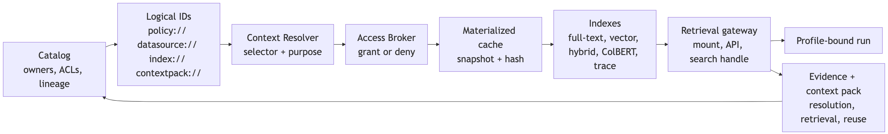
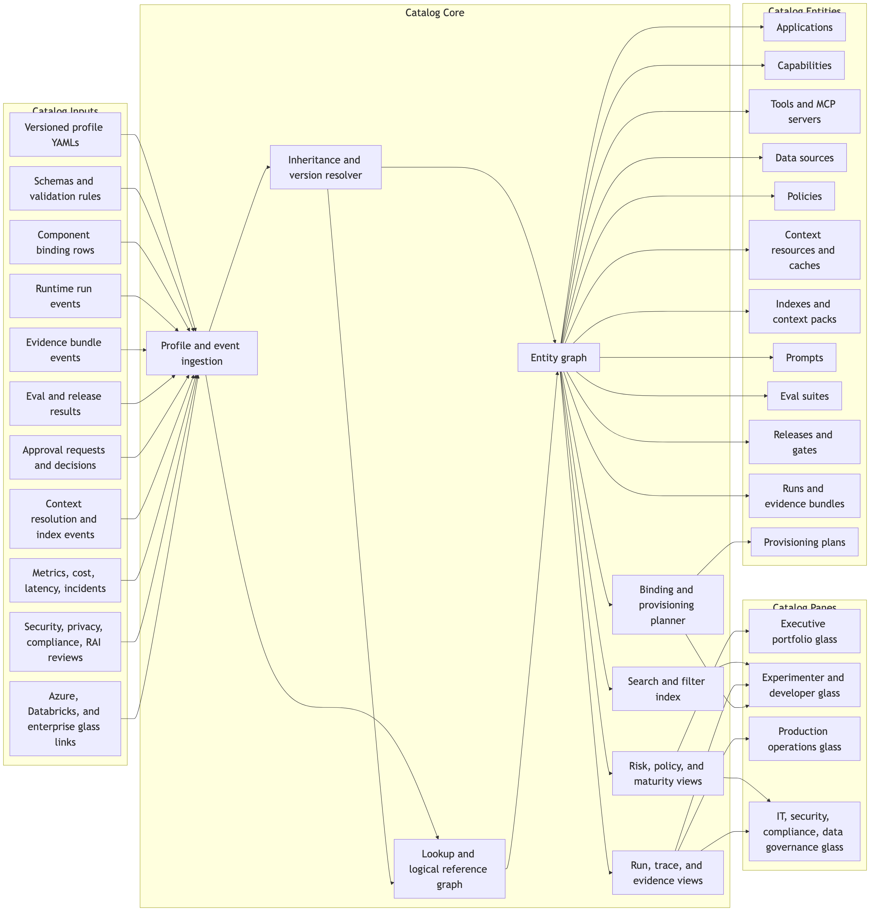
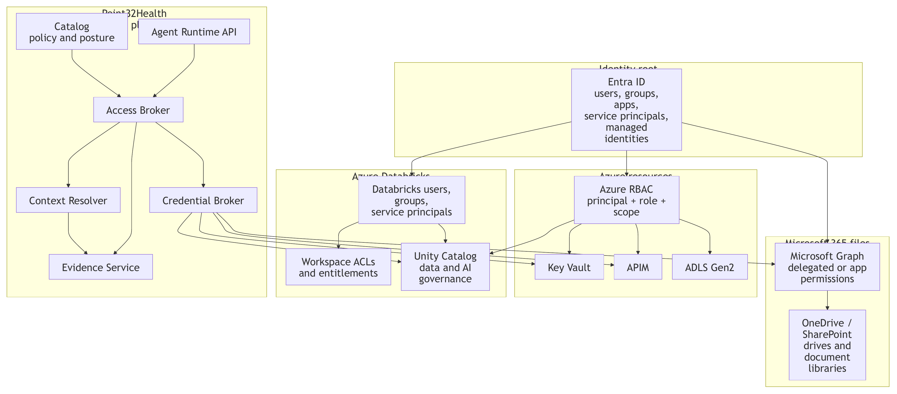
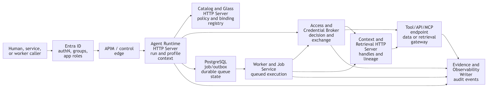
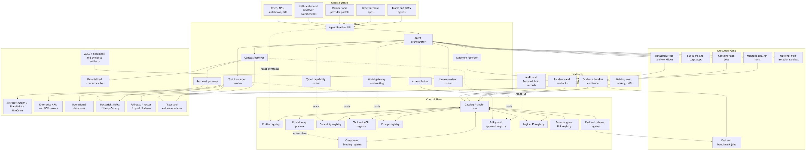
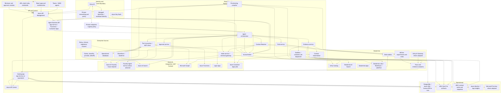

## Point32Health Agentic AI {.hero-title data-section="Opening" data-title="Point32Health Agentic AI Technical Architecture"}

[Technical architecture]{.eyebrow}

::: hero-subtitle
A reference architecture for governed, reusable agentic applications across profile, catalog, runtime, brokered access, context, evidence, eval, and release planes.
:::

::: why-line
**The engineering question: how do every app, agent, worker, and surface share the same control contracts before production?**
:::

::: chip-row
[Profiles]{.chip .theme-profile}[Catalog]{.chip .theme-catalog}[Runtime]{.chip .theme-runtime}[Evidence]{.chip .theme-evidence}[Release gates]{.chip}
:::

::: notes
Use this as the architectural frame. The BBVA example follows to explain why the platform must make adoption fast, visible, and controlled rather than leaving usage to harden invisibly.
:::

## BBVA shows why regulated AI adoption needs a managed platform path {data-section="Pre-story" data-title="BBVA Shows Why Managed Adoption Needs Platform Services"}

[Regulated-bank example]{.eyebrow}

::: lead
BBVA is useful technically because it turned hidden AI demand into a governed path: secure entry, fast approval, observable use, human ownership, and reusable patterns before unmanaged usage became the default.
:::

<strong>Managed entry point</strong>Users had a supported way to reach AI services instead of copying sensitive work into unsanctioned tools.

<strong>Human ownership</strong>Prompt privacy, ownership rules, and quality expectations kept people accountable for outputs.

<strong>Reusable patterns</strong>Champions, use cases, internal GPTs, and shared prompts made adoption visible and productizable.

<strong>Evidence loop</strong>Usage, quality, controls, and outcomes became measurable enough to improve the next wave.

::: {.callout .neutral}
For Point32Health, the platform implication is concrete: every approved surface should enter through profile, catalog, runtime, broker, resolver, evidence, eval, and release contracts instead of becoming another local exception.
:::

::: source-line
Source: Garicano, Li & Wu, *Messy Jobs*, ch. 7, "BBVA: escaping pilot purgatory"; user-provided screenshots.
:::

::: notes
Use this as the bridge from adoption story to architecture: the bank example is not a technology prescription; it is a platform requirement.
:::

## Engineering now has a concrete build sequence {.hero-title data-section="Build Sequence" data-title="Engineering Now Has A Concrete Build Sequence"}

[Technical package orientation]{.eyebrow}

::: why-line
**The current document package turns the architecture into an executable sequence: intake first, trace capture second, review/archive plus memory seed third, then the first full application proof.**
:::

<b>1</b><strong>Thin intake spine</strong>Project, run, agent-client, raw-trace, canonical-trace, and evidence IDs.

<b>2</b><strong>Managed harness capture</strong>Codex and Claude Code-style sessions launch with instrumentation and review context.

<b>3</b><strong>Review and memory seed</strong>Specs, outputs, HTML artifacts, feedback, archives, summaries, context-pack candidates, and simple indexes.

<b>4</b><strong>Synthetic Benefits MVP</strong>First full app proof across profile, broker, resolver, runtime, HITL, evals, and catalog glass.

<b>5</b><strong>Pilots and capabilities</strong>DAIS, payer workflows, shared capabilities, and release-gated reuse.

<b>6</b><strong>AI-native expansion</strong>River-like operating model only after governed memory and evidence are real.

::: source-line
Sources: `readmefirst.md`, `implspec.md` Section 21, `catalog.md`, `agent_harnesses.md`, `evals.md`
:::

## Uniform Standards {.section-divider data-section="Technical" data-title="Axis 1: Uniform Standards"}

[Axis 1]{.eyebrow}

::: lead
Profiles, catalog records, runtime APIs, bindings, access decisions, evidence events, eval suites, and release gates are the stable surfaces that every implementation plugs into.
:::

::: chip-row
[Profile]{.chip .theme-profile}[Catalog]{.chip .theme-catalog}[Runtime]{.chip .theme-runtime}[Evidence]{.chip .theme-evidence}[Broker]{.chip}[Resolver]{.chip}[Release]{.chip}
:::

## How An LLM Agent Run Works {.diagram-slide .title-hidden data-section="Technical" data-title="How An LLM Agent Run Works"}

{.zoomable}

::: notes
Use this as the technical vocabulary primer. It keeps the terms generic before introducing Point32Health-specific profile, catalog, runtime, and evidence names.
:::

## Anatomy Of An AI Application {.diagram-slide .title-hidden data-section="Technical" data-title="Anatomy Of An AI Application"}

{.zoomable}

::: notes
Use this to anchor the four semantic lanes used throughout the deck: profile, catalog, runtime, and evidence.
:::

## A buildable substrate for governed, reusable agentic applications {.hero-title data-section="Technical" data-title="What The Technical Architecture Is Solving"}

[Reference architecture]{.eyebrow}

::: hero-subtitle
The architecture prevents each application from rebuilding runtime, access, tool governance, evidence, eval, approval, release, and observability primitives. The common substrate lets teams move faster while making the work visible and controllable.
:::

<strong>Problem</strong>Local app stacks hide risk, duplicate controls, and make evidence and reuse inconsistent.

<strong>Architecture</strong>Profiles, catalog, runtime, broker, resolver, evidence, evals, and deployment bindings.

<strong>Outcome</strong>Complete visibility, safer delivery, shared capabilities, and staged production readiness.

::: source-line
Sources: `conceptspec.md`, `implspec.md`, `catalog.md`, `profilespec.md`
:::

## The platform loop is profile, catalog, runtime, evidence, then the next controlled turn {data-section="Technical" data-title="The Core Loop: Profile, Catalog, Runtime, Evidence"}

[System loop]{.eyebrow}

::: core-cycle-layout

<strong>Same contract every run</strong>Evidence turns execution into audit, evals, optimization input, and release proof.

<b>1</b><strong>Profile</strong>Purpose, surfaces, users, authority, data/tools, sandbox, evals, release, and risk.

<b>2</b><strong>Catalog</strong>Resolved profile, ownership, bindings, policies, approvals, metrics, incidents, and reuse candidates.

<b>3</b><strong>Runtime</strong>Profile-bound run, brokered access, context resolution, capability calls, and approval routing.

<b>4</b><strong>Evidence</strong>Trace events, artifacts, evals, audit export, feedback, optimizer inputs, and release proof.

resolve contract<b>&rarr;</b>

publish controls<b>&rarr;</b>

write proof<b>&rarr;</b>

gate and learn<b>&rarr;</b>

::: {.aside-panel .theme-evidence}
### Implementation rule

Any UI, batch job, notebook, or external agent client should enter through this loop instead of bypassing profile, catalog, runtime, or evidence contracts.

<strong>Profile</strong> is the typed input.

<strong>Catalog</strong> is the system of record.

<strong>Runtime</strong> is the enforcement point.

<strong>Evidence</strong> is the proof and learning layer.

:::
:::

## An agentic application is a governed composition, not just an agent {data-section="Technical" data-title="Applications Are Profile-Bound Compositions"}

[Application model]{.eyebrow}

::: three-col
::: {.card .metric-card style="--accent: var(--green)"}
**Business surface**

React app, Teams, portal, call-center console, reviewer workbench, API, batch, notebook, IVR.
:::

::: {.card .metric-card .theme-runtime}
**Runtime composition**

Lead agent, deterministic services, retrievers, tools, typed capabilities, sandbox jobs, approval objects.
:::

::: {.card .metric-card .theme-profile}
**Governance envelope**

Authority, data class, policies, evidence, evals, observability, release gates, risks, implementation bindings.
:::
:::

::: code-card
    composition:
      component_policy: single_lead_agent
      components:
        - synthetic_benefits_domain_agent
        - synthetic_plan_document_retriever
        - synthetic_eligibility_lookup
        - evidence_bundle_writer
        - approval_router
:::

## Profiles are human-readable contracts and machine-actionable inputs {data-section="Technical" data-title="Profile YAML Contract"}

[Profile model]{.eyebrow}

::: four-col
::: {.card .theme-profile}
**Intent**

Business purpose, domain, owners, users, value hypothesis, maturity.
:::

::: {.card .theme-profile}
**Authority**

Surfaces, default authority level, autonomous actions, approval-required actions, prohibited actions.
:::

::: {.card .theme-runtime}
**Runtime**

Composition, data, access modes, tools, execution, sandbox, implementation bindings.
:::

::: card
**Controls**

Human review, evidence, evals, observability, security, regulatory, release, operations, risks.
:::
:::

::: code-card
    authority:
      default_level: L1_DRAFT
    access:
      access_broker_required: true
      ambient_credentials_allowed: false
    sandbox:
      network_policy: deny_by_default
    evidence:
      bundle_required: true
    evals:
      release_gate_required: true
:::

## Profile sections map directly to platform behavior {.u-dense data-section="Technical" data-title="Profile Sections Define Service Behavior"}

[Profile section map]{.eyebrow}

::: lead
The resolved profile is the typed control document consumed by catalog, validators, provisioning preview, runtime, brokers, resolvers, evidence, evals, release gates, and operational views.
:::

<table class="matrix" aria-label="Profile sections and platform consumers">
<thead><tr><th>Decision area</th><th>Profile sections</th><th>Platform behavior</th></tr></thead>
<tbody>
<tr><td>Portfolio identity</td><td><code>metadata</code>, <code>catalog</code>, <code>business</code>, <code>maturity</code>, <code>risks</code></td><td>Owner views, value hypothesis, lifecycle state, portfolio filters, risk review.</td></tr>
<tr><td>Entry and users</td><td><code>surfaces</code>, <code>users</code></td><td>Allowed UI/API/batch entry points, identity classes, external-facing risk flags.</td></tr>
<tr><td>Authority and data</td><td><code>authority</code>, <code>data</code>, <code>access</code>, <code>tools</code></td><td>Autonomous actions, approvals, PHI posture, logical refs, broker grants, tool risk.</td></tr>
<tr><td>Runtime shape</td><td><code>composition</code>, <code>execution</code>, <code>sandbox</code></td><td>Lead agent/workflow graph, durable modes, sandbox substrate, network and secrets policy.</td></tr>
<tr><td>Human control</td><td><code>human_in_loop</code></td><td>Reviewer roles, approval actions, escalation triggers, edit-and-approve paths.</td></tr>
<tr><td>Proof and gates</td><td><code>evidence</code>, <code>evals</code>, <code>observability</code>, <code>release</code></td><td>Required events, artifacts, metrics, eval suites, release gates, rollback readiness.</td></tr>
<tr><td>Production readiness</td><td><code>security</code>, <code>regulatory</code>, <code>operations</code>, <code>implementation_bindings</code>, <code>provisioning</code></td><td>Least privilege, HIPAA/docs, runbooks, selected resources, preview/apply jobs.</td></tr>
</tbody>
</table>

::: {.callout .theme-profile}
Field-level lineage matters: reviewers need to know which values came from the base profile, which were overridden by the app, and which loosened controls need approval.
:::

::: source-line
Source: `profilespec.md` sections 3-4
:::

## Profile fragments show how one schema changes runtime and governance {.u-dense data-section="Technical" data-title="Profile Fragments Exercise The Same Contract"}

[Profile examples]{.eyebrow}

::: lead
These authored profiles keep the same base contract but change surfaces, authority, logical IDs, access modes, binding refs, HITL triggers, evidence, and release risk.
:::

<strong>Benefits explanation</strong>Logical source plus prompt/eval refs
<pre>metadata.name: benefits_explanation_app
authority.default_level: L1_DRAFT
data.classification: phi_pii
data.sources:
- logical_id: datasource://point32health/benefits/prod/plan_documents
access_mode: retrieval
implementation_bindings:
prompt_refs: [prompt://point32health/benefits/prod/domain_agent/default]
eval_refs: [eval://point32health/benefits/prod/golden_set/v1]
hitl.gates: [formal_determination]</pre>

<strong>Provider directory integrity</strong>Batch flow, provider-removal gate
<pre>metadata.name: provider_directory_integrity_app
surfaces: [ops_dashboard, provider_portal, batch]
authority.default_level: L2_RECOMMEND
data.classification: confidential
data.sources:
- logical_id: datasource://point32health/providers/prod/directory
access_mode: api_delta_event
writeback.mode: approval_required
hitl.gates: [provider_removal, network_status]</pre>

<strong>Medical necessity review</strong>Highly restricted reviewer assist
<pre>metadata.name: medical_necessity_review_app
component_pattern: multi_agent_application
authority.default_level: L2_RECOMMEND
data.classification: highly_restricted
data.sources:
- logical_id: datasource://point32health/clinical/prod/prior_auth_packet
access_mode: mounted_snapshot
sandbox.egress: deny_by_default
hitl.gates: [adverse_determination]</pre>

<strong>Claims exception resolution</strong>Recommendation with controlled writeback
<pre>metadata.name: claims_exception_resolution_app
surfaces: [claims_workbench, batch_queue]
authority.default_level: L2_RECOMMEND
data.classification: highly_restricted
data.sources:
- logical_id: datasource://point32health/claims/prod/pended_claims
access_mode: readonly_delta
writeback.mode: approval_required
hitl.gates: [payment_change, denial, fwa_referral]</pre>

::: {.callout .neutral}
When a profile references a logical URL such as `datasource://...` or `prompt://...`, the selected concrete binding belongs in the catalog binding registry and release binding set, not in agent code.
:::

::: source-line
Source: `profiles.md` application-profile examples
:::

## Synthetic Benefits shows how a resolved profile drives runtime, broker, resolver, and release controls {.u-tight data-section="Technical" data-title="Synthetic Benefits Exercises The Full Profile Contract"}

[Profile deep dive]{.eyebrow}

::: lead
One project can exercise the full contract without PHI: app identity and authority, component graph, logical data refs, brokered access, context materialization, evidence, evals, and bindings.
:::

<strong>App envelope and authority</strong>Inherited base plus app-specific guardrails
<pre>metadata.name: synthetic_benefits_navigator_app
inheritance.parent: enterprise_healthcare_agent_base
maturity.stage: prototype
surfaces.allowed_surface_types: [react_app, api, cli, hitl_console]
authority:
default_level: L1_DRAFT
allowed_actions: [retrieve_context, call_tools, draft_response]
approval_required_for: [mark_response_as_approved, simulated_send_response]
prohibited_actions: [use_real_phi, use_real_member_data, perform_real_writeback]</pre>

<strong>Components, access, and sandbox</strong>How the runtime constrains execution
<pre>composition.component_policy: single_lead_agent
components:
- synthetic_benefits_domain_agent: agent
- synthetic_plan_document_retriever: retrieval_service
- synthetic_eligibility_lookup: tool
- evidence_bundle_writer: service/platform_candidate
access:
access_broker_required: true
default_access_duration: run_scoped
ambient_credentials_allowed: false
sandbox.network_policy: deny_by_default</pre>

<strong>Logical data and context</strong>Catalog refs resolve to approved handles
<pre>data:
data_classification: internal
logical_reference_required: true
sources:
- logical_id: datasource://point32health/synthetic/dev/plan_documents
type: markdown_document_corpus
access_mode: retrieval
- logical_id: datasource://point32health/synthetic/dev/accumulators
type: csv_table
access_mode: database_readonly
context_resources:
- logical_id: datasource://point32health/synthetic/dev/plan_documents
resolver: static_local
indexes: [index://point32health/synthetic/dev/plan_documents/fulltext?at=build:1]</pre>

<strong>Evidence, evals, and bindings</strong>Release readiness is explicit
<pre>human_in_loop.escalation_triggers:
[missing_plan_document, conflicting_data, low_confidence]
evidence:
bundle_required: true
required_events: [run_created, profile_resolved, access_decision, context_resolved, retrieval, tool_call, model_call, approval, eval_result]
evals:
eval_types: [golden_set, citation_fidelity, tool_correctness, refusal, regression]
release_gate_required: true
implementation_bindings:
infrastructure_stack_ref: deploy/infrastructure/dev
prompt_registry_refs: [prompts/synthetic_benefits/domain_agent/v0.1]
eval_suite_refs: [evals/synthetic_benefits/golden_set/v0.1]</pre>

::: {.callout .neutral}
At runtime, these fields become concrete checks: resolve profile, compute broker grants, materialize context, enforce HITL, write evidence, run eval gates, and attach the selected binding set.
:::

::: source-line
Source: `profilespec.md` Synthetic Benefits overlay and resolved value view
:::

## Child profiles declare app-specific facts while inheriting enterprise controls {data-section="Technical" data-title="Inheritance Makes Enterprise Controls Reusable"}

[Profile inheritance]{.eyebrow} 

<strong>Base profile</strong>Section set, defaults, allowed values, control expectations, evidence/eval/security/release posture.

<strong>Child overlay</strong>App-specific purpose, surfaces, components, data sources, tools, context, metrics, risks, bindings.

<strong>Resolved profile</strong>Merged view consumed by catalog, validators, runtime, broker, resolver, evals, provisioning, evidence.

::: callout
The resolver should preserve source lineage for each field: inherited, overridden, added, rejected, or accepted as an extension.
:::

## The resolved profile is the shared input to control, runtime, and governance services {data-section="Technical" data-title="Resolved Profiles Feed The Whole Platform"}

[Contract consumption]{.eyebrow}

::: five-col
::: {.card .theme-catalog}
**Catalog**

Pages, panes, lookup names, maturity, owners, risks.
:::

::: card
**Provisioning**

Binding preview, selected resources, approvals, glass links.
:::

::: {.card .theme-runtime}
**Runtime**

Run envelope, allowed surface, tools, capabilities, budgets.
:::

::: {.card .theme-catalog}
**Broker/Resolver**

Access decision, logical refs, context handles, lineage.
:::

::: {.card .theme-evidence}
**Evidence/Evals**

Required events, artifacts, metrics, thresholds, release gates.
:::
:::

::: code-card
    source lineage per field:
      profile: synthetic_benefits_navigator_app
      parent: enterprise_healthcare_agent_base
      field_path: access.ambient_credentials_allowed
      value: false
      resolution: inherited
      consumed_by: [runtime, access_broker, security_glass, release_gate]
:::

## The system must make agentic work visible at portfolio, runtime, and control levels {data-section="Technical" data-title="Complete Visibility Is A Platform Requirement"}

[Visibility]{.eyebrow}

::: three-col
::: {.card .metric-card .theme-catalog}
**Technical visibility**

Profiles, components, tools, APIs, MCP servers, data sources, logical references, prompts, evals, and bindings.
:::

::: {.card .metric-card .theme-runtime}
**Runtime visibility**

Runs, state, context resolution, retrieval, model calls, tool calls, sandbox jobs, outputs, and approvals.
:::

::: {.card .metric-card style="--accent: var(--rose)"}
**Security visibility**

Identity posture, access decisions, PHI/PII exposure, credential exchange, policy versions, exceptions, incidents, and signoff.
:::
:::

<table class="matrix">
<thead><tr><th>Question</th><th>Catalog answer</th></tr></thead>
<tbody>
<tr><td>What can this app access?</td><td>Profile data section, logical references, access modes, broker policy, binding rows, evidence events.</td></tr>
<tr><td>What did this run do?</td><td>Run timeline, access decision, context handles, retrieval, tool/model calls, outputs, approvals, eval result.</td></tr>
<tr><td>What can be reused?</td><td>App-local components, consumers, typed capability candidates, eval/readiness signals, owner and release state.</td></tr>
</tbody>
</table>

## The governed runtime binds five surrounding planes during a run {data-section="Technical" data-title="Five-Plane Architecture Map"}

[Architecture map]{.eyebrow}

::: {.diagram-frame .strip}
{.zoomable}
:::

::: diagram-caption
Current figure from `conceptspec.pdf`
:::

## Surfaces normalize user and system entry points into profile-bound runtime calls {data-section="Technical" data-title="Surfaces Are Adapters, Not Platforms"}

[Access surface plane]{.eyebrow} 

<strong>Surface</strong>Teams, React, portal, console, API, batch, notebook, IVR.

<strong>APIM edge</strong>Authentication, route policy, quotas, gateway controls.

<strong>Runtime API</strong>Creates run, validates profile/surface/release.

<strong>Shared services</strong>Broker, resolver, tools, model route, evidence, approval.

<strong>Catalog</strong>Displays run, evidence, risk, release, metrics, and incidents.

::: callout
Adding a new UI should not create a new security model, evidence model, or tool-access model.
:::

## The platform supplies the support stack that every app would otherwise rebuild {data-section="Technical" data-title="The Common Agentic Substrate"}

[Shared substrate]{.eyebrow}

::: four-col
::: {.card .theme-catalog}
**Control**

Catalog, profile registry, bindings, provisioning, policies, prompts, eval/release registry.
:::

::: {.card .theme-runtime}
**Runtime**

Run lifecycle, durable workflow, capability router, model gateway, tool invocation, approval routing.
:::

::: card
**Access/context**

Access Broker, Credential Broker, Context Resolver, materialization, cache, indexes, retrieval gateway.
:::

::: {.card .theme-evidence}
**Governance**

Evidence bundles, traces, observability, cost, evals, release gates, incidents, capability graduation.
:::
:::

::: chip-row
[Profiles]{.chip .theme-profile}[Catalog]{.chip .theme-catalog}[Broker]{.chip}[Resolver]{.chip .theme-catalog}[Tool registry]{.chip}[Sandbox]{.chip .theme-runtime}[HITL]{.chip}[Evidence]{.chip .theme-evidence}[Evals]{.chip .theme-evidence}[Observability]{.chip .theme-evidence}
:::

## Company memory is a governed index over managed runs and evidence {data-section="Technical" data-title="Governed Company Memory Bank"}

[Durable memory bank]{.eyebrow}

::: lead
A Teams thread, harness session, product run, batch workflow, or Databricks job should all resolve to the same profile-bound session, evidence, and catalog model so useful work can be inspected and reused later.
:::

<strong>Work surface</strong>Teams, app, API, notebook, batch, reviewer workbench, harness.

<strong>Managed run</strong>Run envelope, actor, profile, release, state, brokered context.

<strong>Evidence timeline</strong>Prompt, access, retrieval, model, tool, approval, eval, output.

<strong>Catalog memory</strong>Products, capabilities, prompts, context packs, decisions, owners.

<strong>Reusable asset</strong>Approved profiles, eval cases, skills, playbooks, and lessons learned.

<table class="matrix">
<thead><tr><th>Managed-memory input</th><th>System of record</th><th>Guardrail</th></tr></thead>
<tbody>
<tr><td>Harness and chat work</td><td>Runtime session + catalog surface refs</td><td>Permission boundary and owner review</td></tr>
<tr><td>Products and patterns</td><td>Profile/catalog registry</td><td>Release state and binding set</td></tr>
<tr><td>Evidence and lessons</td><td>Canonical trace/evidence bundle</td><td>Retention, redaction, reuse eligibility</td></tr>
</tbody>
</table>

::: callout
Project AI helps one team finish a task. Governed company memory preserves the residue of the task so the next team starts from evidence, not a blank prompt.
:::

::: source-line
Sources: `catalog.md`, `agent_harnesses.md`, `implspec.md`, `evals.md`
:::

## Harness Intake Foundation {.section-divider data-section="Harness Intake" data-title="Technical Deep Dive: Harness Intake Foundation"}

[Intake before app proof]{.eyebrow}

::: lead
Before the first full application MVP, the platform should prove that employee-used agents can be registered, launched, captured, normalized, redacted, summarized, and reviewed without PHI exposure or broad credentials.
:::

::: chip-row
[Codex]{.chip .theme-runtime}[Claude Code]{.chip .theme-runtime}[Project IDs]{.chip .theme-catalog}[Raw traces]{.chip .theme-evidence}[Canonical traces]{.chip .theme-evidence}[Review queue]{.chip}
:::

## Managed agent sessions enter through a launch envelope {.u-dense data-section="Harness Intake" data-title="Managed Harness Session Envelope"}

[Harness runtime]{.eyebrow}

::: lead
The first runtime slice does not need every application feature. It needs a managed launch context that names the project, run, agent client, allowed data class, instrumentation profile, collector route, and review obligations.
:::

::: two-col

<strong>Register</strong>Approved agent client, owner, allowed use, tool policy.

<strong>Launch</strong>Project/run IDs, workspace, hook refs, collector route.

<strong>Constrain</strong>No broad credentials, no PHI by default, scoped files/tools.

<strong>Capture</strong>Prompt, context, files, tools, artifacts, reviewer notes.

<strong>Review</strong>Trace health, candidate resources, approval state.

::: code-card
    managed_session:
      project_ref: project://point32health/platform/dev/agentic_intake_demo
      agent_client_ref: agentclient://point32health/platform/dev/codex
      instrumentation_ref: instrumentation://point32health/platform/dev/codex-otel-v1
      allowed_data_class: internal_non_phi
      evidence_required: [raw_trace, canonical_trace, artifacts, reviewer_notes]
      ambient_credentials_allowed: false
:::
:::

::: source-line
Sources: `agent_harnesses.md` Sections 8-12, `securityspec.md` Section 18.1
:::

## Raw traces become canonical evidence before they become memory {data-section="Harness Intake" data-title="Raw Trace To Canonical Evidence"}

[Trace conversion]{.eyebrow}

::: lead
The platform should preserve the copied raw trace, but use a canonical trace and evidence record for audit, evals, search, memory review, and catalog promotion.
:::

<strong>Managed run</strong>Interactive harness session with run, project, agent-client, and instrumentation IDs.

<strong>Raw trace</strong>Native transcript, telemetry, hooks, files touched, artifacts, errors, costs.

<strong>Normalizer</strong>Maps native events into stable run, tool, model, file, artifact, and reviewer event types.

<strong>Canonical trace</strong>Redaction state, evidence references, provenance packet, and reuse eligibility.

<strong>Decision point</strong>Keep audit-only, create eval case, draft catalog resource, or propose memory/context candidate.

::: {.callout .theme-evidence}
The memory layer must not treat trace residue as truth by default. Reuse requires classification, redaction, retention, poisoning/staleness checks, and owner approval.
:::

::: source-line
Sources: `agent_harnesses.md` Sections 10-13, `catalog.md` Governance Workflows, `future_practices.md` Section 6
:::

## Approved traces seed memory and context, not broad prompt history {.u-dense data-section="Harness Intake" data-title="Trace-Fed Memory Seed"}

[Memory seed]{.eyebrow}

::: lead
The first reusable-memory layer should be deliberately small: project memory files, trace summaries, cache manifests, context-pack candidates, simple BM25/full-text indexes, and draft catalog candidates.
:::

<table class="matrix">
<thead><tr><th>Trace-derived artifact</th><th>Minimum control</th><th>Catalog value</th></tr></thead>
<tbody>
<tr><td>Project memory file</td><td>Owner, source trace, retention, sensitivity, unresolved assumptions.</td><td>Lets the next run start with reviewed project context.</td></tr>
<tr><td>Trace summary</td><td>Raw/canonical refs, redaction state, reviewer note, confidence.</td><td>Supports audit, search, and human handoff without exposing the full transcript.</td></tr>
<tr><td>Cache or context-pack candidate</td><td>Source hashes, ACL, allowed profiles, freshness, approval state.</td><td>Creates reusable context only when policy allows reuse.</td></tr>
<tr><td>Simple index coverage</td><td>Source set, build ID, excluded paths, tenant/project scope.</td><td>Shows what the prototype can retrieve and what it cannot.</td></tr>
<tr><td>Draft catalog candidate</td><td>Observed vs inferred vs AI-drafted vs approved fields separated.</td><td>Turns repeated work into profiles, prompts, tools, eval cases, or capabilities.</td></tr>
</tbody>
</table>

::: source-line
Sources: `catalog.md` Prototype-Supporting Catalog MVP, `agent_harnesses.md` Section 16, `evals.md` Section 6
:::

## The architecture names logical services; the baseline implementation keeps ownership practical {data-section="Technical" data-title="17 Logical Services, 8 Owned Deployables"}

[Implementation packaging]{.eyebrow}

::: two-col
::: {.card .metric-card .theme-profile}
**17 logical services**

Stable platform capabilities exposed to profiles, runtime, provisioning, catalog views, governance, and operations.
:::

::: {.card .metric-card .theme-catalog}
**8 owned deployables**

Initial Point32Health-operated units that host related logical services while using Azure, Databricks, and enterprise managed backends.
:::
:::

::: callout
The service count should not be read as 17 custom servers. Only rows named HTTP Server in the baseline table are long-lived custom HTTP services.
:::

::: source-line
Source: `implspec.md` Sections 2.1 and 2.2
:::

## Eight baseline units define ownership for the first controlled implementation {data-section="Technical" data-title="Baseline Deployable Ownership"}

[Owned implementation units]{.eyebrow} <table class="matrix">
<thead><tr><th>Unit</th><th>Main responsibility</th></tr></thead>
<tbody>
<tr><td>Catalog and Glass HTTP Server</td><td>Registries, profile resolution, approvals, release/eval records, provisioning preview, role-aware UI.</td></tr>
<tr><td>Agent Runtime HTTP Server</td><td>Run lifecycle, durable session state, orchestrator handoff, sandbox dispatch, kill switch.</td></tr>
<tr><td>Access and Credential Broker HTTP Server</td><td>Policy decision, token/session exchange, run-scoped credential/cache policy.</td></tr>
<tr><td>Context and Retrieval HTTP Server</td><td>Logical ID resolution, context-pack resolution, retrieval handles, lineage.</td></tr>
<tr><td>Evidence and Observability Writer HTTP Server</td><td>Canonical append API for evidence, trace, cost, observability, and imported summaries.</td></tr>
<tr><td>Worker, Sandbox, Tool/API/MCP Pack</td><td>Queued work, isolated execution, and gateway-backed tool/API/MCP wrappers.</td></tr>
</tbody>
</table>

## HTTP servers validate and enqueue; workers perform long-running work {data-section="Technical" data-title="Queue-Backed Worker Rule"}

[Execution boundary]{.eyebrow} 

<strong>Request</strong>Caller asks for run, provisioning, eval, index, import, or sandbox work.

<strong>Control API</strong>Validates caller, profile, policy, approval, and idempotency key.

<strong>Job/outbox</strong>PostgreSQL durable state stores lease, retry, dead-letter, evidence refs.

<strong>Worker</strong>Requests fresh broker access at execution time and performs the work.

<strong>Evidence</strong>Progress, completion, failure, policy version, output, and rollback refs.

::: callout
Queue payloads carry logical IDs, handles, policy versions, run IDs, and idempotency keys. They do not carry reusable secrets or raw PHI payloads.
:::

## The catalog is where profile intent, binding choices, runtime evidence, and governance posture meet {data-section="Technical" data-title="Catalog As The Technical System Of Record"}

[Catalog core]{.eyebrow}

::: {.diagram-frame .tall}
{.zoomable}
:::

## Catalog URLs are the routing contract between profiles, harnesses, resolvers, bindings, and evidence {.u-dense data-section="Technical" data-title="Catalog URLs Are The Routing Contract"}

[Logical reference contract]{.eyebrow}

::: lead
Services exchange logical references instead of physical paths, endpoints, or vendor IDs. The catalog, runtime, harness intake, broker, and resolver choose the approved binding for the caller, profile, environment, release, and policy state.
:::

::: {.chip-row .scheme-row aria-label="Catalog logical reference schemes"}
[`project://`]{.chip .theme-catalog}[`app://`]{.chip .theme-catalog}[`agentclient://`]{.chip .theme-catalog}[`instrumentation://`]{.chip .theme-catalog}[`hook://`]{.chip .theme-catalog}[`collector://`]{.chip .theme-catalog}[`rawtrace://`]{.chip .theme-catalog}[`traceimport://`]{.chip .theme-catalog}[`run://`]{.chip .theme-catalog}[`trace://`]{.chip .theme-catalog}[`review://`]{.chip .theme-catalog}[`reviewevent://`]{.chip .theme-catalog}[`artifact://`]{.chip .theme-catalog}[`datasource://`]{.chip .theme-catalog}[`index://`]{.chip .theme-catalog}[`contextpack://`]{.chip .theme-catalog}[`prompt://`]{.chip .theme-catalog}[`eval://`]{.chip .theme-catalog}[`release://`]{.chip .theme-catalog}[`glass://`]{.chip .theme-catalog}
:::

::: {.code-card .url-card}
    <scheme>://point32health/<domain-or-platform-area>/<environment>/<object-path>?<selector>

    prompt://point32health/benefits/prod/domain_agent/default?at=stage:approved
    datasource://point32health/benefits/staging/plan_documents?at=snapshot:2026-06-01
    eval://point32health/benefits/prod/golden_set/v1
    trace://point32health/benefits/prod/run_abc123/evidence
    project://point32health/platform/dev/agentic_intake_demo
    agentclient://point32health/platform/dev/codex
    rawtrace://point32health/platform/dev/codex/session/native_session_123
    traceimport://point32health/platform/dev/codex-hook-normalizer-v1
    review://point32health/platform/dev/research/run_20260813_001/spec-review
    reviewevent://point32health/platform/dev/research/run_20260813_001/spec-review/cmt_03
    artifact://point32health/platform/dev/research/run_20260813_001/reviews/spec-review
:::

<table class="matrix">
<thead><tr><th>Segment</th><th>Platform behavior</th></tr></thead>
<tbody>
<tr><td><code>scheme</code></td><td>Selects object family: project, app, agent client, instrumentation, hook, collector, raw trace, trace import, run, trace, review, feedback event, artifact, data, index, context pack, prompt, eval, release, glass.</td></tr>
<tr><td><code>area</code></td><td>Finds owner domain, platform service, policy scope, and portfolio grouping.</td></tr>
<tr><td><code>environment</code></td><td>Chooses dev, staging, or prod binding set and permission posture.</td></tr>
<tr><td><code>selector</code></td><td>Pins version, stage, snapshot, build, release, commit, or timestamp.</td></tr>
</tbody>
</table>

::: {.callout .neutral}
Resolver outputs include the physical handle, policy version, binding row, snapshot or artifact hash, and evidence reference needed for replay and audit.
:::

::: source-line
Sources: `catalog.md` Universal Logical References, `implspec.md` Section 7.1, `agent_harnesses.md` Sections 10-12
:::

## POST /runs is the main entry point for access surfaces {.u-dense data-section="Technical" data-title="Runtime API And Run Lifecycle"}

[Runtime plane]{.eyebrow} 

<strong>Resolve</strong>Application profile and inherited defaults.

<strong>Validate</strong>Surface, user/app identity, release, budget.

<strong>Record</strong>Durable run ID and initial evidence.

<strong>Broker</strong>Access decisions for data/tools/context.

<strong>Invoke</strong>Tools, capabilities, model route, sandbox jobs.

<strong>Review</strong>Register review surfaces, feedback events, and live endpoints.

<strong>Return</strong>Status, outputs, approval state, evidence link.

::: code-card
    POST /runs
    {
      "application_profile": "synthetic_benefits_navigator_app",
      "surface": "benefits_demo_react_app",
      "user_context": {"roles": ["benefits_sme"]},
      "task": {"type": "benefits_question"},
      "requested_outputs": ["answer", "citations", "limitations"]
    }
:::

## Review surfaces give HITL a richer runtime contract {.u-dense data-section="Technical" data-title="Review Surface Runtime Contract"}

[Review object model]{.eyebrow}

::: lead
The same HITL mechanism should expose Markdown specs, output drafts, static HTML bundles, live reviewer apps, eval reports, and external glass views through catalog-owned endpoints.
:::

::: {.code-card .url-card}
    review://point32health/benefits/dev/run_abc123/spec-review
    app://point32health/benefits/dev/hitl/run_abc123/spec-review
    hitl://point32health/benefits/dev/run_abc123/review/spec-review
    reviewevent://point32health/benefits/dev/run_abc123/spec-review/cmt_03
    artifact://point32health/benefits/dev/run_abc123/reviews/spec-review
:::

<table class="matrix">
<thead><tr><th>Backing mode</th><th>Use it for</th><th>Archive</th></tr></thead>
<tbody>
<tr><td>Markdown/spec review</td><td>Plans, specs, rubrics, release notes.</td><td>Source, rendered HTML, feedback manifest.</td></tr>
<tr><td>Static HTML artifact</td><td>Generated sites, dashboards, browser-test replays.</td><td>Asset bundle, hashes, screenshot, feedback.</td></tr>
<tr><td>Live HITL app</td><td>Temporary reviewer UI, prototype, eval workbench.</td><td>Static export where possible; screenshot/HAR/log manifest otherwise.</td></tr>
<tr><td>External glass</td><td>Azure, Databricks, Foundry, Purview, GitHub, SharePoint views.</td><td>External ID/URL, synced status, local decision evidence.</td></tr>
</tbody>
</table>

::: {.callout .neutral}
Generated HTML is useful but untrusted: sandboxed frame, strict CSP, no ambient credentials, signed expiring access, hash checks, and scans before agent reuse.
:::

## The catalog can be operational without becoming a shadow admin portal {data-section="Technical" data-title="Catalog Read/Write Control Model"}

[Glass behavior]{.eyebrow}

::: three-col
::: {.card .metric-card .theme-catalog}
**Reads through owners**

Provider APIs, platform APIs, telemetry exports, event imports, and external glass links.
:::

::: {.card .metric-card .theme-catalog}
**Writes through workflows**

Typed platform APIs, provisioning compiler, policy API, approval API, and provider drivers.
:::

::: {.card .metric-card .theme-evidence}
**Stores evidence**

Action request, actor, policy version, binding row, provider resource, result, rollback or revocation handle.
:::
:::

<table class="matrix">
<thead><tr><th>Action</th><th>Write path</th><th>Catalog record</th></tr></thead>
<tbody>
<tr><td>Provision resource</td><td>Preview, approval, queued worker, provider driver</td><td>Plan, job ID, resource IDs, links, rollback</td></tr>
<tr><td>Disable tool/model route</td><td>Runtime/API gateway/model policy driver</td><td>Actor, reason, affected releases, evidence</td></tr>
<tr><td>Launch eval/red-team run</td><td>Eval control API, queued worker, Foundry/MLflow driver</td><td>Dataset, job ID, results, gate impact</td></tr>
</tbody>
</table>

## A relational registry spine makes lookup, lineage, versioning, and promotion practical {data-section="Technical" data-title="Registry API And Relational Spine"}

[Registry model]{.eyebrow}

::: {.two-col .wide-left}
<table class="matrix">
<thead><tr><th>Core table</th><th>Purpose</th></tr></thead>
<tbody>
<tr><td>registry_objects</td><td>Governed object by type, key, owner, risk, status.</td></tr>
<tr><td>registry_object_versions</td><td>Immutable profile, prompt, policy, schema, tool, binding, release versions.</td></tr>
<tr><td>registry_relationships</td><td>Typed graph across apps, tools, data, policies, releases, evidence.</td></tr>
<tr><td>registry_bindings</td><td>Concrete implementation rows by provider, environment, resource.</td></tr>
<tr><td>registry_events</td><td>Append-only audit trail for create, approve, select, provision, sync.</td></tr>
</tbody>
</table>

::: {.aside-panel .theme-catalog}
### Why relational first

Owners, releases, approvals, versions, policy assignments, evidence links, and external glass links need joins, constraints, and version history. Large artifacts can live in ADLS/Blob/Delta.
:::
:::

## Evidence Traces {.section-divider data-section="Technical" data-title="Axis 2: Evidence Traces"}

[Axis 2]{.eyebrow}

::: lead
The platform records who asked, what profile and release were used, which access was granted, which context was retrieved, which tools and models ran, who approved, which evals passed, and what artifacts were produced.
:::

::: chip-row
[Run timeline]{.chip .theme-evidence}[Access envelope]{.chip}[Context lineage]{.chip .theme-catalog}[Guardrail events]{.chip .theme-evidence}[Eval results]{.chip .theme-evidence}[Audit export]{.chip .theme-evidence}
:::

## The evidence bundle must reconstruct the run without trusting the agent's memory {data-section="Technical" data-title="Evidence Bundle Model"}

[Evidence schema]{.eyebrow}

::: three-col
::: {.card .metric-card .theme-evidence}
**Run identity**

Human/caller, app, surface, capability, workload identity, environment, release, approval state, run ID.
:::

::: {.card .metric-card .theme-evidence}
**Control events**

Profile resolution, policy decision, credential/handle exchange, context resolution, guardrail result, eval gate.
:::

::: {.card .metric-card .theme-evidence}
**Artifact lineage**

Snapshots, indexes, prompts, model routes, tool calls, outputs, hashes, storage refs, raw/redacted state.
:::
:::

<table class="matrix">
<thead><tr><th>Evidence use</th><th>Required behavior</th></tr></thead>
<tbody>
<tr><td>Audit and compliance</td><td>Export chain of custody, policy versions, reviewer decisions, source links, retention and legal-hold state.</td></tr>
<tr><td>Debug and replay</td><td>Recover the exact profile, release, context handle, prompt/config, model route, tool path, and output artifact.</td></tr>
<tr><td>Reuse and evals</td><td>Separate raw trace, redacted trace, eval case, optimizer input, and memory artifact with distinct approvals.</td></tr>
</tbody>
</table>

## Reuse And Cooperation {.section-divider data-section="Technical" data-title="Axis 3: Reuse And Cooperation"}

[Axis 3]{.eyebrow}

::: lead
Profiles, inherited controls, typed capabilities, bounded subagents, tool registries, and approved handoffs let teams cooperate while preserving scope, budget, authority, and evidence.
:::

::: chip-row
[Profile inheritance]{.chip .theme-profile}[Typed capabilities]{.chip .theme-profile}[Subagents]{.chip .theme-runtime}[Handoffs]{.chip .theme-runtime}[Tool registry]{.chip .theme-catalog}
:::

## Synthetic Benefits is the first full application proof after intake works {data-section="Full App Proof" data-title="Synthetic Benefits Is The First Full Application Proof"}

[Full app proof]{.eyebrow}

::: two-col
::: {.aside-panel .theme-profile}
### Why it comes after intake

The intake spine proves run identity, trace capture, canonical evidence, review state, and memory candidates first. Synthetic Benefits then exercises the full app path without PHI or source-system writeback.

::: chip-row
[Profiles]{.chip .theme-profile}[Broker]{.chip}[Resolver]{.chip}[Retrieval]{.chip}[HITL]{.chip}[Evals]{.chip .theme-evidence}
:::
:::

Catalog renders base profile, Synthetic Benefits overlay, logical refs, bindings, and release gate.

Profile resolves allowed surfaces, authority, synthetic data, tools, evidence, evals, and approval rules.

Broker grants scoped synthetic data access and resolver selects snapshot/cache/index handles.

Runtime retrieves plan context, calls tools, drafts answer, and routes review where needed.

Evidence captures access, context, retrieval, tool/model calls, approvals, evals, and citations.

Catalog shows successful and blocked runs, eval state, observability, and candidate reuse.

:::

::: source-line
Sources: `prototype.md`, `catalog.md` Prototype-Supporting Catalog MVP, `implspec.md` Phase 2
:::

## Reusable capabilities are invoked through typed contracts, not arbitrary agent conversations {data-section="Technical" data-title="Typed Capabilities Replace Free-Form Agent Chatter"}

[Composability]{.eyebrow}

::: two-col
::: {.card .metric-card style="--accent: var(--rose)"}
**Bad control protocol**

Benefits Agent asks Claims Agent in natural language what happened with a claim, inheriting unclear context and authority.
:::

::: {.card .metric-card style="--accent: var(--green)"}
**Good control protocol**

Benefits app invokes `claims.accumulator_explanation@v1` with validated inputs and receives typed outputs plus evidence refs.
:::
:::

::: code-card
    capability:
      name: claims.accumulator_explanation
      allowed_callers: [benefits_explanation_app, claims_exception_resolution_app]
      input:
        member_ref: scoped_member_id
        plan_year: integer
        claim_refs: list[claim_ref]
      output:
        answer: markdown
        accumulator_events: list[accumulator_event]
        evidence_refs: list[evidence_ref]
:::

## Subagents are allowed when their scope, tools, context, budget, and evidence are explicit {data-section="Technical" data-title="Bounded Subagents And Handoffs"}

[Delegation model]{.eyebrow} 

<strong>Lead run</strong>Profile-bound app owns user contract, authority, release state, and final evidence.

<strong>Context packet</strong>Pass task-specific files, source refs, constraints, and stop conditions instead of full transcript.

<strong>Child agent</strong>Research, review, retrieval, test triage, policy lookup, or document comparison with scoped tools.

<strong>Handoff trace</strong>Parent/child run IDs, tool calls, guardrails, cost, intermediate outputs, and synthesis refs.

<strong>Gate</strong>Human or evaluator review before high-impact use, promotion, or reusable capability graduation.

::: callout
Recursive delegation deeper than one level stays watchlist until depth, cost, termination, handoff validation, and trace-inspection controls are mature.
:::

## App-local components become shared capabilities only after they earn it {data-section="Technical" data-title="Capability Graduation Enables Reuse"}

[Reuse path]{.eyebrow} 

<strong>App-local</strong>Useful inside one profile with local assumptions.

<strong>Candidate</strong>Second consumer or repeated pattern appears.

<strong>Typed beta</strong>Contract, allowed callers, owner, evals, evidence hooks.

<strong>Stable</strong>Versioning, release gate, observability, runbook, security review.

<strong>Primitive</strong>Platform-owned capability with multiple consumers and cost/quality telemetry.

::: callout
Likely graduates: evidence bundle writer, approval router, access broker, context resolver, retrieval/index gateway, document understanding, provider identity resolution, Delta table query tool.
:::

## Tools are registered, risk-scored, allowlisted, versioned, routed, and evidenced {data-section="Technical" data-title="Tool, MCP, And API Registry Pattern"}

[Tool governance]{.eyebrow} 

<strong>Register</strong>Tool, MCP server, API route, operation contract, owner.

<strong>Classify</strong>Risk level, data class, writeback/external communication flags.

<strong>Authorize</strong>Allowed callers, broker policy, approval requirements.

<strong>Route</strong>APIM/API Center/MCP gateway/function/backend route.

<strong>Record</strong>Request/response summary, redaction, output, evidence ref.

 <table class="matrix">
<thead><tr><th>Registry field</th><th>Why it matters</th></tr></thead>
<tbody>
<tr><td>allowed_callers</td><td>Prevents broad reuse outside approved profiles.</td></tr>
<tr><td>operation_contract</td><td>Validates input/output and supports SDK/schema generation.</td></tr>
<tr><td>evidence_hook</td><td>Ensures tool use appears in run evidence and release review.</td></tr>
</tbody>
</table>

## Security And Compliance {.section-divider data-section="Technical" data-title="Axis 4: Security And Compliance"}

[Axis 4]{.eyebrow}

::: lead
The platform composes identity, brokered access, sandboxing, PHI controls, compliance signoff, environment, release state, approval, and evidence before access or promotion.
:::

::: chip-row
[No ambient credentials]{.chip}[Access envelope]{.chip}[Credential broker]{.chip}[Prompt/tool guardrails]{.chip}[Compliance signoff]{.chip}
:::

## Every material run joins the identities and controls needed for one bounded task {data-section="Technical" data-title="Composed Run Identity"}

[Identity model]{.eyebrow}

::: five-col
::: card
**Caller**

Human, service job, app identity, allowed surface, role facts.
:::

::: {.card .theme-profile}
**Profile**

Application, capability, authority level, tool policy, release state.
:::

::: card
**Resource**

Data source, context pack, index, tool, MCP route, model route, artifact.
:::

::: card
**Environment**

Dev, synthetic, staging, production, regulated workspace, data-side execution.
:::

::: {.card .theme-evidence}
**Evidence**

Run ID, policy version, access decision, approval basis, retention state.
:::
:::

::: code-card
    identity root + RBAC facts + profile policy + purpose + data classification
      + approval state + environment + release state
      -> access decision
      -> short-lived credential or handle
      -> evidenced use
:::

## The broker turns identity facts into run-scoped authorization {data-section="Technical" data-title="Access Broker Decision Model"}

[Access broker]{.eyebrow}

::: five-col
::: card
**Who**

User, app identity, surface, service principal, group.
:::

::: {.card .theme-profile}
**What**

Profile, capability, tool/API/MCP operation, data source.
:::

::: card
**Why**

Purpose, task, environment, maturity, release state.
:::

::: card
**Risk**

Data class, PHI/PII, writeback, high-impact action, external comms.
:::

::: card
**State**

Approval, exception, policy version, TTL, evidence obligations.
:::
:::

::: code-card
    {
      "decision": "grant",
      "granted_mode": "mounted_snapshot",
      "scope": {"document_id": "doc-456", "version": "v12", "mode": "read_only"},
      "expires_at": "2026-06-03T15:05:00Z",
      "policy_ref": "access/sharepoint_contract_readonly.policy.yaml"
    }
:::

## Agents receive handles and artifacts; credentials stay inside platform boundaries {data-section="Technical" data-title="Credential Broker And Short-Lived Access"}

[Credential boundary]{.eyebrow}

::: three-col
::: {.card .metric-card .theme-runtime}
**Allowed exchange outputs**

OBO delegated token server-side, managed identity call, signed URL, retrieval handle, read-only snapshot, MCP session.
:::

::: {.card .metric-card style="--accent: var(--teal)"}
**Disallowed exposure**

Prompts, traces, queues, context cache, semantic cache, and agents must not receive broad reusable credentials.
:::

::: {.card .metric-card style="--accent: var(--green)"}
**Broker cache stance**

Only encrypted, scoped, TTL-bound, revocable, evidenced, and broker-internal when performance requires it.
:::
:::

::: callout
Credential cache, semantic cache, context/materialization cache, queue state, and trace/evidence stores are separate security domains.
:::

## Point32Health policy composes enterprise identity and cloud-specific controls {data-section="Technical" data-title="Identity Layers: Entra, Azure RBAC, Graph, Databricks, Unity Catalog"}

[Identity and authorization]{.eyebrow}

::: {.diagram-frame .medium}
{.zoomable}
:::

::: diagram-caption
Current figure from `identity_auth_layers.pdf`
:::

## Every material run routes through identity, profile policy, brokered access, workers, tools, and evidence {data-section="Technical" data-title="Run-Scoped Security Flow"}

[Security flow]{.eyebrow}

::: {.diagram-frame .strip .security-strip}
{.zoomable}
:::

::: {.four-col .compact}
::: {.card .theme-runtime}
**Runtime**

Creates run envelope before source access.
:::

::: {.card .theme-catalog}
**Catalog**

Supplies profile, policy, release, binding, approval facts.
:::

::: card
**Broker**

Grants, denies, scopes, exchanges, and logs access.
:::

::: {.card .theme-evidence}
**Evidence**

Platform services write audit events instead of trusting agent self-logging.
:::
:::

## Untrusted content may inform answers, but it must not become operational authority {data-section="Technical" data-title="Prompt And Tool Injection Guardrails"}

[Guardrail stack]{.eyebrow}

::: three-col
::: {.card .metric-card style="--accent: var(--rose)"}
**Source controls**

Label retrieved chunks, trace memory, tool responses, uploads, and context packs by trust, data class, owner, lineage, and reuse eligibility.
:::

::: {.card .metric-card style="--accent: var(--amber)"}
**Action controls**

Run prompt/document attack detection, task-adherence checks, tool gates, model/output inspection, and red-team evals.
:::

::: {.card .metric-card style="--accent: var(--violet)"}
**Escalation controls**

Block, redact, route to reviewers, or require exception records depending on environment, data, tool, and impact.
:::
:::

::: callout
Guardrail evidence records detector/evaluator version, mode, decision, severity, policy version, source/context IDs, route, reviewer target, and release gate consumed.
:::

## Sandbox jobs and external agent clients run as controlled execution workloads {data-section="Technical" data-title="Sandbox And External Agent Client Security"}

[Execution plane]{.eyebrow}

::: three-col
::: {.card .metric-card style="--accent: var(--teal)"}
**Inputs**

Explicit artifacts, context handles, allowed tools, run-scoped credentials only when unavoidable.
:::

::: {.card .metric-card .theme-runtime}
**Runtime policy**

Signed images, deny-by-default egress, resource limits, timeout/kill policy, ephemeral filesystem.
:::

::: {.card .metric-card style="--accent: var(--green)"}
**Outputs**

Artifact-only outputs, evidence hooks, log redaction, cleanup, telemetry import for external clients.
:::
:::

::: code-card
    sandbox:
      required_for: [document_ingestion, chunking, index_building]
      substrate: local_docker_then_container_apps
      network_policy: deny_by_default
      filesystem_policy: ephemeral_only
      secrets_policy: broker_injected_short_lived
      image_policy: signed_images_required
:::

## System staging must fail closed when required evidence or signoff is missing {data-section="Technical" data-title="Compliance And HITL Release Gate"}

[Release gate]{.eyebrow}

::: three-col
::: {.card .metric-card .theme-evidence}
**Evidence required**

Profile, release, prompt, model, data, tool, broker, guardrail, eval, approval, retention, and rollback versions.
:::

::: {.card .metric-card style="--accent: var(--violet)"}
**Human approval**

Writeback, external communication, clinical, financial, adverse, regulatory, exception, and PHI reuse paths need role-qualified review.
:::

::: {.card .metric-card style="--accent: var(--rose)"}
**Promotion blockers**

Unresolved high-risk findings, missing guardrail evidence, unclear redaction posture, unowned exceptions, or untested incident paths.
:::
:::

<table class="matrix">
<thead><tr><th>Reviewer function</th><th>Decision scope</th></tr></thead>
<tbody>
<tr><td>Data and source owners</td><td>Classification, minimum necessary access, lineage, reuse permission, source constraints.</td></tr>
<tr><td>Security, IT/IAM, platform</td><td>Identity, broker posture, gateways, sandbox, monitoring, revocation, route controls.</td></tr>
<tr><td>Compliance, privacy, RAI, operations</td><td>PHI handling, auditability, eval adequacy, residual AI risk, rollback, incident readiness.</td></tr>
</tbody>
</table>

## Environment is part of the contract, so promotion cannot hide inside app code {data-section="Technical" data-title="Environment-Explicit Release Gates"}

[Release control]{.eyebrow}

::: lead
The catalog stores selected binding rows for each profile version, environment, and release. URLs and logical IDs make `dev`, `staging`, and production token `prod` explicit; release gates record what passed before promotion.
:::

<h3>Dev</h3>

Local or synthetic bindings, schema validation, smoke evals, evidence event coverage, and prototype owner approval.

<code>.../dev/...</code>

<h3>Staging</h3>

Production-like bindings, broker policy, guardrails, HITL routing, regression evals, runbook, and rollback rehearsal.

<code>.../staging/...</code>

<h3>Production</h3>

Approved release version, immutable binding set, monitoring, incident hooks, kill switch, and catalog-visible rollback target.

<code>.../prod/...</code>

::: {.code-card .small}
    environment: staging
    logical_id: datasource://point32health/synthetic/staging/plan_documents
    binding_set: release-binding-set://synthetic-benefits/staging/v3
    release_gate: release-gate://synthetic-benefits/promote-to-production
    gate_requires: [eval_pass, approval, broker_policy, evidence_trace, rollback]
:::

::: source-line
Sources: `catalog.md` lookup/binding model, release page, governance workflows
:::

## HITL And Easy Evals {.section-divider data-section="Technical" data-title="Axis 5: HITL And Easy Evals"}

[Axis 5]{.eyebrow}

::: lead
The platform turns human review, guardrail results, eval suites, audit export, exceptions, and rollback readiness into reusable release-gate machinery.
:::

::: chip-row
[Qualified reviewers]{.chip}[Fail-closed gates]{.chip}[Audit export]{.chip}[Red-team scans]{.chip}[Rollback]{.chip}
:::

## Evals start with harness capture, then move to application behavior {.u-dense data-section="Evals" data-title="Harness Capture And Application Eval Path"}

[Evaluation path]{.eyebrow}

::: lead
The first eval question is whether the platform can capture and normalize managed agent work. The second is whether Synthetic Benefits answers safely and with evidence. Foundry and other tools are useful backends, while the catalog remains the release record.
:::

<table class="matrix">
<thead><tr><th>Eval layer</th><th>What it checks</th><th>Gate before moving on</th></tr></thead>
<tbody>
<tr><td>Harness capture evals</td><td>Prompt, context, files touched, tool calls, artifacts, review surfaces, feedback events, archive manifests, cost/error/completion state.</td><td>Run, project, agent-client, raw-trace, canonical-trace, evidence, and redaction state are present.</td></tr>
<tr><td>Trace-memory evals</td><td>Approved summaries, memory files, cache records, context-pack candidates, and BM25/full-text index records.</td><td>Observed, inferred, AI-drafted, and approved catalog facts are clearly separated.</td></tr>
<tr><td>Synthetic Benefits local suite</td><td>15-25 benefits questions, answer accuracy, citation fidelity, retrieval completeness, refusal, tool correctness, no PHI leakage.</td><td>Release gate blocks unsupported writeback, missing citation, PHI leakage, or critical answer failure.</td></tr>
<tr><td>Foundry bridge</td><td>Eligible case export, Foundry evaluator runs, row results, local/human comparison, external links.</td><td>Catalog stores the lineage and decides which external evals are advisory or gating.</td></tr>
</tbody>
</table>

::: source-line
Source: `evals.md` Section 6
:::

## Runs become promotable only when evidence and evals support the release state {data-section="Technical" data-title="Evidence, Evals, Release Gates, And Observability"}

[Governance plane]{.eyebrow} 

<strong>Evidence</strong>Run, profile, access, context, retrieval, prompt, model, tool, sandbox, output, approval.

<strong>Evals</strong>Golden set, regression, citation fidelity, safety, latency, cost, human agreement.

<strong>Release</strong>Gate result, failing cases, approver decisions, rollback target, exceptions.

<strong>Observability</strong>Run count, active users, p95 latency, cost, failure, fallback, approval, drift.

<strong>Operations</strong>Incidents, runbooks, kill switches, rollback, disabled routes/tools/models.

::: {.callout .theme-evidence}
The catalog connects these views so technical debugging, security review, compliance audit, and executive visibility use the same underlying evidence record.
:::

## User Simplicity And Future Readiness {.section-divider data-section="Technical" data-title="Axis 6: User Simplicity And Future Readiness"}

[Axis 6]{.eyebrow}

::: lead
Users should get stable, compliant workflows while context memory, subagents, managed-agent platforms, optimization, and adaptive learning evolve behind catalog-visible controls.
:::

::: chip-row
[No technical burden on users]{.chip}[Experiment records]{.chip .theme-catalog}[Optimizer artifacts]{.chip .theme-evidence}[Redacted traces]{.chip .theme-evidence}[Promotion gates]{.chip .theme-evidence}
:::

## Context Memory And Trace Reuse {.section-divider data-section="Technical" data-title="Technical Deep Dive: Context Memory And Trace Reuse"}

[Technical deep dive]{.eyebrow}

::: lead
The future-practices work makes context packs, hybrid retrieval, trace-derived memory, and compaction first-class catalog artifacts with lineage, ACLs, retention, validation, and reuse rules.
:::

::: chip-row
[Logical IDs]{.chip .theme-catalog}[Hybrid retrieval]{.chip .theme-catalog}[Context packs]{.chip .theme-catalog}[Compaction]{.chip .theme-evidence}[Trace-derived memory]{.chip .theme-evidence}
:::

## Profiles and runs use logical references; resolver services select approved physical context {data-section="Technical" data-title="Logical IDs And Context Resolver"}

[Context contract]{.eyebrow}

::: {.diagram-frame .strip}
{.zoomable}
:::

::: code-card
    data:
      sources:
        - logical_id: datasource://point32health/synthetic/dev/plan_documents
    context_resources:
      - logical_id: datasource://point32health/synthetic/dev/plan_documents
        materialized_snapshot: snapshot://synthetic-benefits-demo/plans/v1
        indexes:
          - index://point32health/synthetic/dev/plan_documents/fulltext?at=build:1
:::

## Context work must preserve lineage, policy, and evidence across derived artifacts {data-section="Technical" data-title="Materialization, Cache, Index, And Retrieval Handles"}

[Data and context plane]{.eyebrow} 

<strong>Source</strong>SharePoint, OneDrive, API, DB, Delta, policy docs, traces.

<strong>Snapshot</strong>Version, hash, retention, ACL, redaction state.

<strong>Cache</strong>Materialized context under policy and freshness rules.

<strong>Index</strong>Full-text, vector, hybrid, ColBERT, structured, trace.

<strong>Handle</strong>Retrieval, mount, search session, artifact reference.

<strong>Evidence</strong>Resolution event, retrieval event, source lineage, index build.

 <table class="matrix">
<thead><tr><th>Required metadata</th><th>Why</th></tr></thead>
<tbody>
<tr><td>source hash or selector</td><td>Reproducibility and audit.</td></tr>
<tr><td>ACL and data class</td><td>Minimum necessary and policy enforcement.</td></tr>
<tr><td>chunk/index policy</td><td>Retrieval quality and release-gate comparison.</td></tr>
<tr><td>evidence refs</td><td>Run trace and compliance review.</td></tr>
</tbody>
</table>

## Memory artifacts need separate IDs, approvals, retention rules, and eval gates {data-section="Technical" data-title="Context Packs, Compaction, And Trace Memory"}

[Future-ready memory]{.eyebrow}

::: three-col
::: {.card .metric-card .theme-catalog}
**Context packs**

Catalog artifacts with logical ID, owner, source versions, allowed profiles, sensitivity labels, freshness rules, and expected citations.
:::

::: {.card .metric-card .theme-evidence}
**Compaction**

Derivative summaries with source refs, unresolved decisions, constraints, omitted-context warnings, validation status, and replay links.
:::

::: {.card .metric-card .theme-evidence}
**Trace memory**

Reusable memory only after redaction/de-identification, permissioning, retention review, poisoning checks, and revocation support.
:::
:::

<table class="matrix">
<thead><tr><th>Artifact</th><th>Governance rule</th></tr></thead>
<tbody>
<tr><td>Raw trace</td><td>Canonical evidence; access stays limited to approved review and audit audiences.</td></tr>
<tr><td>Redacted trace or eval case</td><td>Derivative artifact with its own classification, allowed consumers, hash, and approval basis.</td></tr>
<tr><td>Reusable memory</td><td>Never treated as self-evidently true; must link to sources and pass stale-policy, PHI leakage, and overgeneralization tests.</td></tr>
</tbody>
</table>

## Every future-practice experiment should be catalog-visible before it influences a release {data-section="Technical" data-title="Future-Practice Experiment Records"}

[Adoption control]{.eyebrow}

::: two-col
::: {.aside-panel .theme-catalog}
### Required experiment fields

Hypothesis, affected profile, data class, baseline, evaluation suite, evidence artifacts, promotion gate, rollback target, owner, and allowed environments.

::: {.callout .theme-catalog}
External traces from OpenAI, Azure, Databricks, MLflow, or other tools can be useful, but the catalog remains the enterprise record.
:::
:::

<table class="matrix">
<thead><tr><th>Practice</th><th>Initial stance</th></tr></thead>
<tbody>
<tr><td>Subagents and goal loops</td><td>Bounded internal work with stop conditions, budgets, and parent/child evidence.</td></tr>
<tr><td>Context packs and compaction</td><td>Ready for prototype when source-linked, validated, and policy controlled.</td></tr>
<tr><td>Trace-derived memory</td><td>Only after redaction, approval, retention review, and poisoning/staleness tests.</td></tr>
<tr><td>Managed agent platforms</td><td>Use where useful, mirror essential trace/eval records into the catalog.</td></tr>
</tbody>
</table>
:::

## Optimizers and learned policies propose candidates; they do not update production directly {data-section="Technical" data-title="Prompt Optimization And RL Control Plane"}

[Optimization and learning]{.eyebrow}

::: three-col
::: {.card .metric-card .theme-evidence}
**Prompt/program optimization**

Manual prompts, DSPy/MIPROv2, GEPA, and similar optimizers run offline against approved benchmark corpora.
:::

::: {.card .metric-card .theme-evidence}
**Safe RL-like targets**

Start with routing, retrieval selection, prompt/template selection, tool retry policy, delegation policy, and reviewer queue routing.
:::

::: {.card .metric-card .theme-evidence}
**Release controls**

Candidate artifacts need owners, metrics, safety results, human review where required, rollback targets, and evidence links.
:::
:::

::: code-card
    optimization_record:
      baseline_release: benefits_prompt@v3
      optimizer: GEPA_or_MIPROv2
      inputs: [approved_benchmark, redacted_trace_snapshot]
      gates: [citation_fidelity, PHI_leakage, prompt_injection, cost, latency]
      promotion: reviewer_approved_release_artifact
:::

## Build Roadmap {.section-divider data-section="Roadmap" data-title="Technical Roadmap: Build Roadmap"}

[Technical roadmap]{.eyebrow}

::: lead
The implementation path starts with harness intake and trace-fed memory, proves the first full application with Synthetic Benefits, then hardens through document workflows, payer pilots, shared capabilities, and production controls.
:::

::: chip-row
[Harness intake]{.chip .theme-catalog}[Trace memory]{.chip .theme-evidence}[Synthetic proof]{.chip .theme-profile}[DAIS/docs]{.chip}[Payer pilots]{.chip}[Production hardening]{.chip .theme-evidence}
:::

## Build the intake spine first, then harden through application proofs {.u-dense data-section="Roadmap" data-title="Six-Phase Technical Build Plan"}

[Build path]{.eyebrow} 

<strong>1. Harness intake foundation</strong>Thin catalog, profile binding, managed session launch, raw/canonical trace, evidence writer, review surfaces, memory seed.

<strong>2. Synthetic Benefits MVP</strong>Profile ingestion, broker, resolver, snapshot/cache/index, sandbox job, tool registry, HITL, review pages, evals, glass.

<strong>3. DAIS and document substrate</strong>SharePoint snapshot, DOCX/PDF parser, redline sandbox, approval, writeback, DAIS evals.

<strong>4. Payer use-case pilots</strong>Benefits assist, provider directory, HEDIS, medical necessity review, pended-claim assistant.

<strong>5. Shared capabilities</strong>Evidence writer, access broker, context resolver, materialization/cache, retrieval gateway, review router.

<strong>6. Production and AI-native expansion</strong>Dashboards, release gates, cost, incident runbooks, security tests, prompt/PHI evals, DR, governed memory.

::: callout
Open decisions stay concrete: run identity schema, enterprise role mapping, credential TTLs, break-glass chain, provisioning schema, Databricks handoffs, security glass screens, mandatory evidence schema, and production release gates.
:::

::: source-line
Source: `implspec.md` Section 21 and `securityspec.md` Section 18
:::

## A River-like operating model follows from governed run residue {data-section="AI-Native Expansion" data-title="River-Like Runtime Substrate"}

[AI-native expansion]{.eyebrow}

::: lead
The technical platform earns a River-like operating model only when useful run residue can be promoted into governed memory, context packs, prompts, eval cases, tools, capabilities, decisions, and lessons without bypassing policy.
:::

<strong>Managed work</strong>Harness sessions, Teams, apps, batch jobs, notebooks, reviews.

<strong>Profile-bound session</strong>Owner, purpose, authority, release state.

<strong>Brokered execution</strong>Scoped tools, context, credentials, approvals.

<strong>Evidence bundle</strong>Prompt, access, retrieval, model, tool, eval, output.

<strong>Catalog promotion</strong>Prompt, context pack, capability, eval case, decision.

<strong>Governed memory</strong>Next run starts with scoped, source-linked, revocable prior work.

<table class="matrix">
<thead><tr><th>Reusable asset</th><th>Promotion gate</th><th>Reuse boundary</th></tr></thead>
<tbody>
<tr><td>Prompt or context pack</td><td>Owner approval + eval evidence</td><td>Profile, role, data class, retention</td></tr>
<tr><td>Capability or tool path</td><td>Risk score + broker policy</td><td>Scoped invocation, not ambient credential</td></tr>
<tr><td>Lesson, exception, or incident</td><td>Review outcome + control update</td><td>Catalog-visible, privacy-filtered memory</td></tr>
</tbody>
</table>

::: source-line
Sources: `riverness.md`, `agent_harnesses.md`, `catalog.md`, `securityspec.md`, `evals.md`
:::

::: notes
Use this as the technical payoff slide. It should feel like the end state of the substrate, not the first build step.
:::
## Azure-first implementation with Databricks for lakehouse, Unity Catalog, MLflow, and data-side execution {data-kind="appendix" data-section="Appendix" data-title="Appendix: Azure And Databricks Implementation Map"}

[Appendix figure]{.eyebrow}

::: {.diagram-frame .strip}
{.zoomable}
:::

::: diagram-caption
Current figure from `implspec.pdf`
:::

## Base profile excerpt: inherited enterprise controls {data-kind="appendix" data-section="Appendix" data-title="Appendix: Base Profile Excerpt"}

[Appendix YAML]{.eyebrow}

::: {.code-card .large}
    api_version: agentic.p32h/v0.1
    kind: AgenticApplicationProfile
    metadata:
      name: enterprise_healthcare_agent_base
    catalog:
      visibility:
        value: catalog_visible
      executive_summary_required:
        value: true
      engineering_view_required:
        value: true
    authority:
      default_level:
        value: L1_DRAFT
      approval_required_for:
        value: [source_system_writeback, external_communication, adverse_action,
          payment_change, clinical_determination, pricing_decision, regulatory_filing]
    access:
      access_broker_required:
        value: true
      ambient_credentials_allowed:
        value: false
    evidence:
      bundle_required:
        value: true
    evals:
      required:
        value: true
      release_gate_required:
        value: true
:::

## Synthetic Benefits resolved value view: app-specific controls {data-kind="appendix" data-section="Appendix" data-title="Appendix: Synthetic Benefits Full Contract Slice"}

[Appendix YAML]{.eyebrow}

::: {.code-card .large}
    metadata:
      name: synthetic_benefits_navigator_app
      lifecycle_status: prototype
    inheritance:
      parent: enterprise_healthcare_agent_base
    surfaces:
      allowed_surface_types: [react_app, api, cli, teams, hitl_console]
    authority:
      default_level: L1_DRAFT
      autonomous_actions_allowed: [retrieve, summarize, explain_plan_language, draft_response]
      prohibited_actions: [use_real_phi, use_real_member_data, perform_real_writeback]
    data:
      data_classification: internal
      sources:
        - logical_id: datasource://point32health/synthetic/dev/plan_documents
        - logical_id: datasource://point32health/synthetic/dev/eligibility
        - logical_id: datasource://point32health/synthetic/dev/accumulators
    access:
      allowed_access_modes: [database_readonly, mounted_snapshot, api]
      writeback_default: disabled
    evidence:
      required_events: [run_created, profile_resolved, access_decision, context_resolved,
        snapshot_or_cache_selected, index_selected, retrieval, tool_call, model_call,
        output_artifact, approval, eval_result]
:::

## Runtime payload pattern: profile-bound run creation {data-kind="appendix" data-section="Appendix" data-title="Appendix: Runtime Payload"}

[Appendix JSON]{.eyebrow}

::: code-card
    {
      "application_profile": "dais_contract_redlining_app",
      "surface": "dais_react_app",
      "user_context": {
        "user_id": "user-123",
        "roles": ["legal_reviewer"]
      },
      "task": {
        "type": "contract_redline",
        "description": "Review contract against approved clause policy"
      },
      "artifacts": [{
        "type": "sharepoint_document",
        "document_id": "doc-456",
        "version": "v12"
      }],
      "requested_outputs": ["redlined_docx", "clause_summary", "risk_summary"]
    }
:::

::: source-line
Source: `implspec.md` Section 8.2
:::

## Minimum evidence timeline for a runtime-connected catalog {data-kind="appendix" data-section="Appendix" data-title="Appendix: Evidence Event Set"}

[Appendix schema]{.eyebrow}

::: code-card
    run_created
    profile_resolved
    catalog_lookups_resolved
    implementation_bindings_selected
    surface_validated
    managed_session_launched / trace_imported
    access_decision
    context_resolved
    snapshot_or_cache_selected
    index_selected
    context_pickup_decision
    retrieval
    tool_call
    agent_runner_started / agent_runner_completed
    model_call or mock_model_call
    output_artifact
    approval_requested
    approval_decision
    eval_result
    run_completed
:::

::: source-line
Source: `catalog.md` Prototype Run Timeline and Governance Workflows
:::

## Decisions to close before controlled pilot and production {data-kind="appendix" data-section="Appendix" data-title="Appendix: Production-Hardening Decisions"}

[Appendix decisions]{.eyebrow} <table class="matrix">
<thead><tr><th>Decision</th><th>Why it matters</th></tr></thead>
<tbody>
<tr><td>Run identity schema</td><td>Determines evidence fields, policy evaluation, and incident review.</td></tr>
<tr><td>Enterprise role mapping</td><td>Maps Entra groups, app roles, Azure RBAC, Databricks roles, and Unity grants into policy facts.</td></tr>
<tr><td>Credential TTL classes</td><td>Balances performance, revocation, audit, and source-system risk by environment and data class.</td></tr>
<tr><td>Prompt/tool injection gates</td><td>Defines release-blocking tests for exfiltration, unsafe action, PHI leakage, and hallucinated citations.</td></tr>
<tr><td>Security glass screens</td><td>Defines which controls are read-only, queued actions, or approval-required provider-side effects.</td></tr>
<tr><td>Provisioning schema</td><td>Makes environment, binding policy, generated resources, approvals, and external links explicit in profiles/catalog.</td></tr>
</tbody>
</table>

## Old Slides For Review {.section-divider data-kind="appendix" data-section="Old Slides" data-title="Old Slides For Review"}

[Second appendix]{.eyebrow}

::: lead
These slides were removed from the main technical flow during the intake-first refresh. Keep them here for inspection before deletion or selective pull-back.
:::

## Engineering Needs One Platform {data-kind="appendix" data-section="Old Slides" data-title="Old Slide: Engineering Needs One Platform"}

[Managed platform rationale]{.eyebrow}

::: why-line
**Because every implementation should share the same runtime, access, evidence, memory, compliance, HITL, eval, and release contracts before it reaches production.**
:::

<b>1</b><strong>Uniform Standards</strong>Profiles, APIs, broker rules, evidence, evals, and releases.

<b>2</b><strong>Evidence Traces</strong>Identity, access, context, guardrails, approvals, and outputs.

<b>3</b><strong>Reuse And Cooperation</strong>Typed capabilities, inheritance, subagents, and handoffs.

<b>4</b><strong>Security And Compliance</strong>Run identity, brokered handles, PHI controls, signoff, and release gates.

<b>5</b><strong>HITL And Easy Evals</strong>User-safe workflows, reviewer routing, and reusable eval machinery.

<b>6</b><strong>User Simplicity And Future Readiness</strong>Stable user workflows while memory, optimization, and platform choices evolve.

::: source-line
Sources: `securityspec.md`, `future_practices.md`, `implspec.md`, `catalog.md`
:::

## Synthetic Benefits exercises the full architecture with safe synthetic data {data-kind="appendix" data-section="Old Slides" data-title="Old Slide: Synthetic Benefits As The First Executable Contract"}

[Prototype proof]{.eyebrow}

::: two-col
::: {.aside-panel .theme-profile}
### Question path

User asks whether physical therapy is covered for a synthetic member and what the likely cost is with a selected provider.

::: chip-row
[Plan docs]{.chip}[Eligibility]{.chip}[Accumulators]{.chip}[Provider directory]{.chip}[Benefit config]{.chip}
:::
:::

Profile resolves allowed surfaces, data, tools, evidence, evals, and approval rules.

Broker grants scoped synthetic data access.

Resolver selects synthetic snapshot/cache and simple index.

Runtime retrieves plan context, calls tools, and drafts answer.

Evidence captures timeline, citations, approvals, evals, and improvement candidates.

Catalog displays run timeline, approval, eval, metrics, and profile lineage.

:::

## Build Roadmap {.section-divider data-kind="appendix" data-section="Old Slides" data-title="Old Slide: Technical Roadmap"}

[Technical roadmap]{.eyebrow}

::: lead
The implementation path starts with the executable platform slice, proves the full loop with Synthetic Benefits, then pilots real workflows with stronger security, compliance, eval, and evidence gates.
:::

::: chip-row
[Foundation]{.chip .theme-catalog}[Synthetic proof]{.chip .theme-profile}[Controlled pilots]{.chip}[Production hardening]{.chip .theme-evidence}
:::

## Build the smallest executable platform slice, then harden through pilots {data-kind="appendix" data-section="Old Slides" data-title="Old Slide: Build Plan And Technical Decisions"}

[Build path]{.eyebrow} 

<strong>Foundation</strong>Catalog MVP, YAML schemas, profile ingestion, runtime skeleton, evidence, broker, resolver.

<strong>Synthetic Benefits</strong>Synthetic data, retrieval, tools, evidence timeline, approval, golden evals, metrics.

<strong>DAIS/docs</strong>SharePoint snapshot, DOCX/PDF sandbox, redline generation, writeback approval.

<strong>Payer pilots</strong>Benefits assist, provider audit, HEDIS shadow, MNG, claims pended-claim assistant.

<strong>Production</strong>Release gates, security tests, PHI/prompt evals, dashboards, incident runbooks, DR.

::: callout
Open decisions: enterprise role mapping, credential TTLs, provisioning schema, Databricks handoffs, security glass screens, mandatory evidence schema, production release gates.
:::

## Riverbed makes the runtime an AI-native organization substrate {data-kind="appendix" data-section="Old Slides" data-title="Old Slide: Riverbed Runtime Substrate"}

[Riverbed addition]{.eyebrow}

::: lead
The runtime, broker, resolver, catalog, evidence store, and eval workbench are the Riverbed: the governed layer where useful run residue becomes reusable system capability.
:::

<strong>Harness or product run</strong>Teams, apps, batch jobs, notebooks, reviews.

<strong>Profile-bound session</strong>Owner, purpose, authority, release state.

<strong>Brokered execution</strong>Scoped tools, context, credentials, approvals.

<strong>Evidence bundle</strong>Prompt, access, retrieval, model, tool, eval, output.

<strong>Catalog promotion</strong>Prompt, context pack, capability, eval case, decision.

<strong>Reusable memory</strong>Next run starts with governed prior work.

<table class="matrix">
<thead><tr><th>Riverbed asset</th><th>Promotion gate</th><th>Reuse boundary</th></tr></thead>
<tbody>
<tr><td>Prompt or context pack</td><td>Owner approval + eval evidence</td><td>Profile, role, data class, retention</td></tr>
<tr><td>Capability or tool path</td><td>Risk score + broker policy</td><td>Scoped invocation, not ambient credential</td></tr>
<tr><td>Lesson, exception, or incident</td><td>Review outcome + control update</td><td>Catalog-visible, privacy-filtered memory</td></tr>
</tbody>
</table>

::: source-line
Sources: `riverness.md`, `agent_harnesses.md`, `catalog.md`, `securityspec.md`, `evals.md`
:::
